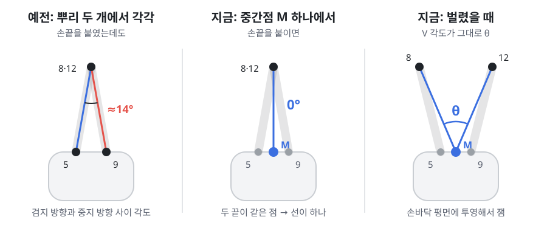
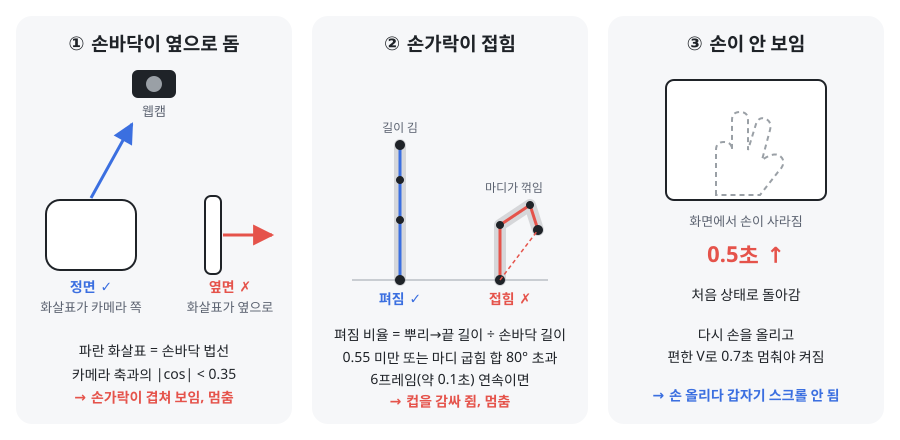
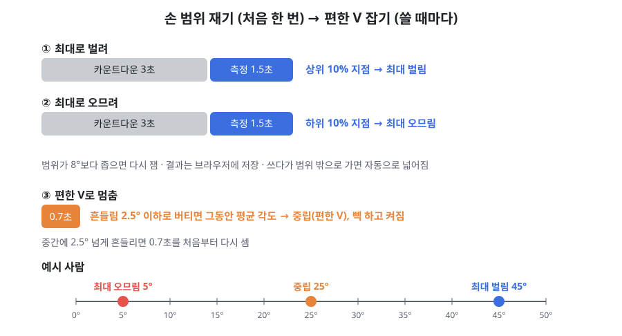
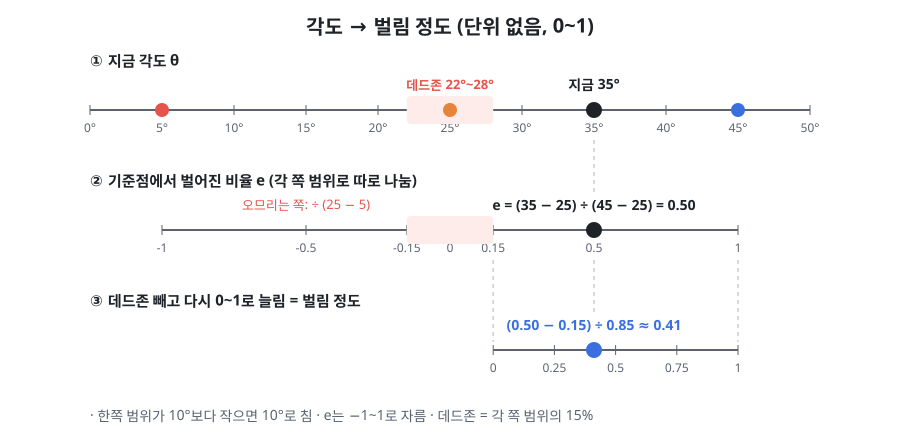
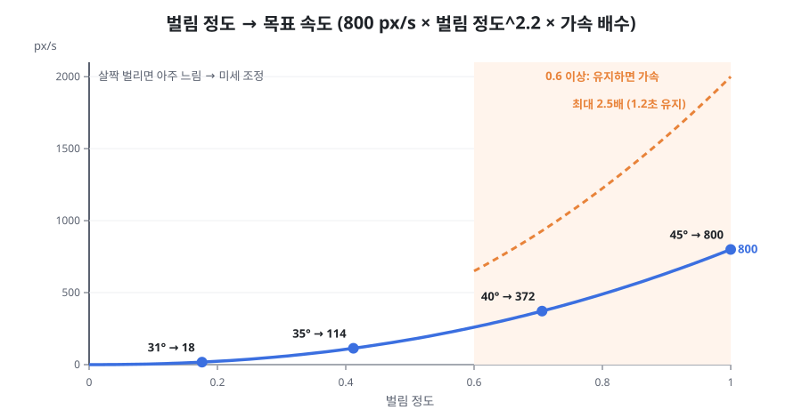
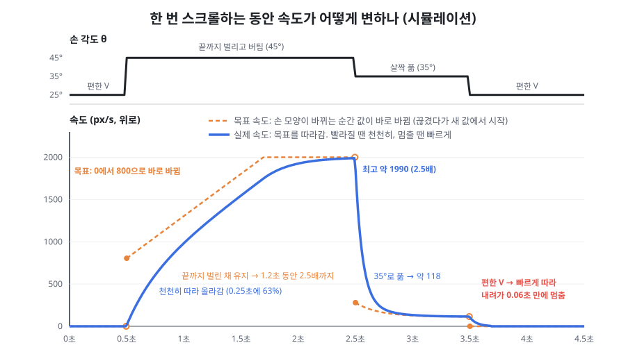

# GripSpread

컵을 든 손 그대로 검지와 중지를 벌렸다 오므려서 노트북 화면을 스크롤하는 입력 기법이다.
노트북 웹캠과 MediaPipe Hands로 손을 추적하고, 손에 아무것도 달지 않은 채 브라우저에서 바로 돌아간다.

CSE333 HCI개론 (UNIST, 2026 가을) Team 10 프로젝트.

[English version below ↓](#english)

## 파일

| 경로 | 내용 |
|---|---|
| `dist/gripspread_core.html` | 데모용 프로토타입. 예시 문서(도시 열섬 강의자료)를 GripSpread로 스크롤해볼 수 있다 |
| `dist/gripspread_experiment.html` | 실험 프로그램. 스크롤 Fitts 과제로 트랙패드와 GripSpread를 비교하고, 순서는 균형 라틴 방격으로 정하고, 끝나면 NASA-TLX를 받는다 |
| `src/engine.js` | 실험 프로그램이 쓰는 GripSpread 엔진 (손 추적 → 벌림 각도 → 상태 → 스크롤 속도) |
| `src/core_template.html` | 프로토타입 원본. 빌드하면 예시 문서 이미지가 안에 들어간다 |
| `src/experiment_template.html` | 실험 프로그램 원본. 빌드하면 `engine.js`가 안에 들어간다 |
| `assets/sample_doc_pages/` | 예시 문서 페이지 이미지 |
| `dist/gripspread_pilot.html` | 파일럿 도구. ① 파일럿 참가자와 값 하나씩 A/B로 맞추기 ② 참가자별 결과를 평균 내서 본 실험 값 만들기 |
| `dist/gripspread_imu_calib.html` | IMU 보정 (실험자 전용, 센서당 한 번) |
| `imu/GripSpread_Portable.html` | 컵 IMU 단독 모니터. 센서 연결, 가상 컵으로 기울기 확인, 원시 데이터 CSV 저장 |
| `docs/` | 아래 설명에 쓰는 그림, 참고 문헌 목록(`docs/references.md`) |

`dist/`의 두 파일은 파일 하나만 있으면 돌아간다. 크롬에서 열고 카메라를 허용하면 된다. 손 인식 모델은 처음 열 때 인터넷에서 받아온다.
컵 IMU를 블루투스로 연결하려면 크롬이나 엣지를 써야 한다. 사파리랑 파이어폭스는 Web Bluetooth를 지원하지 않는다.

## 클라우드 자동 저장 (Supabase, 선택)

켜 두면 조건이 끝날 때마다 가벼운 zip(시행 결과, TLX, 세션 정보, 수 KB)이, 실험이 끝날 때 프레임·IMU까지 들어간 전체 zip이 Supabase Storage에 새 파일로 올라간다 (`P01/<시작시각>/P01_003_after-step-7.zip` … `P01_015_final.zip`). 참가자 한 명에 전체 zip 하나(약 10 MB 안팎)라서 무료 플랜 1 GB 안에 20명 이상 충분히 들어간다. 45 MB가 넘는 파일은 올리지 않고 로컬에만 둔다. 로컬 zip과 브라우저 백업은 그대로라서, 인터넷이 끊겨도 데이터는 남는다. 업로드 기록은 `session.json`의 `cloud_uploads`에 남는다.

**구조:** Supabase 키는 Vercel 서버(`api/`)에만 있고 페이지에는 아무 키도 없다. 실험 프로그램은 `/api/upload-url`에서 파일 하나짜리 일회용 업로드 주소를 받아 zip을 Supabase로 바로 올린다(Vercel 함수는 4.5 MB까지만 받아서 큰 파일은 서버를 거치지 않음). 서버는 실험 프로그램이 만드는 파일 이름만 받고, 이미 있는 파일은 덮어쓰지 않는다. 분석 페이지는 `/api/data`에 연구자 비밀번호를 보내고, 맞으면 참가자별 zip의 10분짜리 내려받기 주소를 받는다. 파일로 연 페이지(file://)에서는 `/api`가 없어서 업로드가 안 되고 로컬 저장만 된다.

**설정 (한 번)**
1. Supabase 대시보드 › Storage › New bucket: 이름 `gripspread`, **Private**. (Bucket 설정에서 파일 크기 제한을 50 MB로 두면 좋다.)
2. Supabase › Project Settings › API Keys에서 **secret 키**(`sb_secret_…`, 예전 이름 service_role)를 복사한다. 이 키는 Vercel 환경 변수에만 넣고 다른 데는 절대 붙이지 않는다.
3. Vercel › 프로젝트 › Settings › Environment Variables에 넣고 다시 배포(Deployments › Redeploy):
   - `SUPABASE_URL` = `https://xxxx.supabase.co`
   - `SUPABASE_SECRET_KEY` = 2의 secret 키
   - `RESEARCHER_PASSWORD` = 팀끼리 정한 분석 페이지 비밀번호
   - (`SUPABASE_BUCKET`은 버킷 이름이 `gripspread`가 아닐 때만)
4. 예전 방식에서 만든 정책은 이제 필요 없다. 익명 업로드 정책은 지워 두는 게 안전하다(SQL Editor):
   ```sql
   drop policy if exists "gripspread: anon can upload" on storage.objects;
   drop policy if exists "gripspread: researchers can read" on storage.objects;
   ```
5. 실험 프로그램 시작 화면 **클라우드 자동 저장**에서 **연결 테스트** → `_test` 폴더에 파일이 올라가면 됨. 자동 업로드는 기본으로 켜져 있다.
6. 분석 페이지 **클라우드에서 불러오기**에 연구자 비밀번호를 넣고 **불러와서 분석**. 비밀번호는 그 브라우저에 기억된다.

받은 파일은 대시보드 Storage에서도 내려받을 수 있다. 무료 프로젝트는 일주일 넘게 안 쓰면 일시정지되니까 실험 기간 전에 대시보드에서 깨워 둔다.

## 파일럿 (값 정하기)

본 실험 값은 연구자끼리 먼저 맞춘 다음, 팀 밖 파일럿 참가자 3~4명과 `dist/gripspread_pilot.html`로 정하고 고정한다. IMU 보정은 참가자 없이 실험자가 `dist/gripspread_imu_calib.html`로 따로 한다. 절차는 Fashimpaur et al. (CHI 2023)의 두 번째 파일럿을 따른다.

1. **IMU 보정 (`gripspread_imu_calib.html`, 실험자만, 센서마다 한 번):** 컵에 붙인 채로 ① 10초 가만히(자이로 영점, 잡음) ② 컵 밑 정육면체 받침의 6면을 차례로 책상에 대고 멈추기(축마다 위/아래 값으로 가속도 영점·1g 크기, 6면이 안 되면 여러 자세 타원체 맞춤) ③ 책상 위에서 360° 두 번 돌리기(자이로 스케일). `imu_calib.json`으로 저장하고, 분석할 때 원시 IMU 값에 적용한다.
2. **값 맞추기 (참가자마다):** 컵 쥔 채 손 범위·편한 V 보정 → 자유 연습 → 값 하나씩(기본: 멈춤 구간, 기본 속도, 곡선 지수. 유지 가속 배수와 가속·감속 반응은 연구자 값으로 고정, 필요하면 체크) 지금 값과 한 칸 바꾼 값을 버전 1/2로 섞어서 각각 6번씩 스크롤(거리 400/1200/3600 × 폭 40/120을 한 번씩) → "어느 쪽이 나았나요?". 바꾼 쪽이 나으면 그 값으로 바꾸고 같은 방향으로 한 칸 더, 지금 값이 나으면 반대 방향을 한 번 시험, 비슷하면 멈춘다. 값 하나에 비교는 최대 4번. 참가자는 어느 쪽이 바뀐 값인지 모른다.
3. **결과 합치기:** 참가자별 `pilot_T1_….json`을 모두 넣으면 값마다 평균을 내서 `gripspread_params.json`을 만든다. 실험 프로그램 시작 화면의 **파일럿 결과 값 불러오기**로 넣고, 본 실험 동안 바꾸지 않는다.

파일럿 참가자는 본 실험에 넣지 않는다.

## 실험 장비와 환경 (모든 참가자 동일)

트랙패드 설정은 트랙패드 성능에 바로 영향을 주니까 모든 참가자에게 같은 기기, 같은 설정으로 하고 그 값을 보고한다. 실험 프로그램 시작 화면의 **장비 확인**에서 매 세션 체크하고, 체크 결과와 화면·창 크기, 카메라 해상도, 브라우저 정보가 `session.json`의 `apparatus`에 자동으로 남는다.

| 항목 | 고정 값 |
|---|---|
| 노트북 | **MacBook Pro 14″ (Apple M5), macOS 26.6.2** (2026-11-07 기준, 장비 칸을 비워 두면 이 값으로 기록). 이 맥북 한 대로 고정. macOS 버전은 크롬이 자동으로 읽어 세션마다 기록하고, 지난 세션과 다르면 경고한다 (`apparatus.macos_changed`) |
| 자동 업데이트 | 실험 기간 동안 끔 (일반 › 소프트웨어 업데이트 › 자동 업데이트). 중간에 OS가 바뀌면 바뀐 세션 번호를 보고서에 적는다 |
| 자연스러운 스크롤 | 켜짐 (시스템 설정 › 트랙패드 › 스크롤 및 확대/축소, macOS 기본값) |
| 스크롤 속도 | 기본값 그대로, 값을 적어 둔다 (손쉬운 사용 › 포인터 제어 › 트랙패드 옵션) |
| 스크롤할 때 관성 사용 | 켜짐 (같은 트랙패드 옵션 창, 기본값) |
| 브라우저 | 크롬, 확대/축소 100%, 창 최대화 |
| 전원 | 전원 연결, 저전력 모드 끔 (카메라 fps와 손 인식 속도 유지) |
| 카메라 | 내장 웹캠 640×480 요청 |
| 자리 | 노트북 위치·각도와 참여자가 설 자리를 테이프로 표시해 두고 그대로. 실험은 외부광이 없는 실내(창이 없거나 블라인드를 닫은 방)에서 천장 조명을 켜고 한다. 웹캠 손 인식이 밝기와 역광에 영향을 받기 때문이다 |
| 컵 | 비즈를 입구 1cm 아래까지 채움, IMU는 컵 바닥에 고정 |

**트랙패드는 macOS 기본값 그대로 쓴다.** 아래 표가 기본값이고, 매 세션 장비 확인에서 체크만 한다. 슬라이더에 숫자가 안 나오므로 눈금 위치로 확인한다 ("몇 번째 눈금 / 전체 눈금 수"). 트랙패드 옵션 창과 트랙패드 설정 화면 스크린샷도 남겨 둔다.
세션마다 터미널에서 `defaults read -g com.apple.trackpad.scrolling`을 실행해 `0.3125`인지 확인한다 (한 칸 위인 6/8은 0.4412). 한 번도 안 바꾼 기기에서는 "does not exist"가 나오는데, 그것도 기본값이라는 뜻이다.

| 설정 | 위치 | 값 |
|---|---|---|
| 스크롤에 트랙패드 사용 | 손쉬운 사용 › 포인터 제어 › 트랙패드 옵션 | 켬 |
| 스크롤할 때 관성 사용 | 같은 창 | 켬 |
| 스크롤 속도 | 같은 창 | 5/8 (왼쪽부터 5번째 눈금, 기본값) · `com.apple.trackpad.scrolling = 0.3125` |
| 자연스러운 스크롤 | 트랙패드 › 스크롤 및 확대/축소 | 켬 |

**화면 각도.** 웹캠이 화면 위에 붙어 있어서 각도가 바뀌면 카메라가 손을 보는 범위가 바뀐다. 키보드 면 기준 105°로 고정한다(파일럿 전 시험에서 컵 든 손이 카메라에 잘 잡힌 각도). 맥북 각도 센서로 105±2°를 맞추고, 센서가 없으면 아이폰 측정 앱의 수평계를 화면 뒷면에 대서 15°(= 105 − 90)가 나오게 맞춘다. 값은 장비 확인에 기록되고(`apparatus.screen_angle_deg`) 다음 세션에 그대로 채워진다.

**화면 각도 확인.** 맥북 힌지의 각도 센서를 크롬(WebHID)으로 바로 읽는다. 장비 확인에서 **맥북 각도 센서 연결**을 누르고 Apple 기기를 고르면 현재 각도가 뜨고, 목표 ±2° 안이면 초록이다. 세션 중에 2° 넘게 바뀌면 `session.json`의 `screen_angle_changes`에 기록된다. 센서가 없는 모델은 아이폰 수평계로 맞춘다.

**카메라 기본 설정.** 실험 프로그램이 지금 쓰는 카메라 이름·해상도·fps를 자동으로 보여주고, 내장(FaceTime) 카메라가 아니면 경고한다(아이폰이 연속성 카메라로 잡히는 경우). macOS 비디오 효과(인물 사진, 스튜디오 조명, 반응, 센터 스테이지, 배경)는 손 인식에 영향을 주므로 제어 센터에서 모두 끈다. 특히 **반응**은 특정 손동작에 화면 효과를 띄운다.

**기록 영상 (폰).** 분석용으로 폰을 거치대에 세워 녹화한다. 위치는 **웹캠과 같은 방향(정면), 노트북 뒤쪽 위에서 내려다보는 높은 각도**(중간 발표 실험 설계 그림의 analysis camera 자리). 웹캠과 시점이 같아 손 추적 로그와 영상을 바로 맞대 볼 수 있고, 손가락 V가 정면에서 보이며, 위에서 보므로 컵을 감싼 손가락과 트랙패드로 뻗는 손이 화면 뚜껑에 덜 가린다. 컵 기울기는 IMU가 재므로 영상으로 볼 필요가 없다. 프레임에는 컵 든 손과 트랙패드가 들어오게 하고 얼굴은 빼며, 거치대 위치와 높이는 테이프·눈금으로 표시해 매번 같게 둔다(줌 1×, 가로, AE/AF 잠금). 동기화용 삐 소리가 녹음되므로 화면이 프레임에 꼭 들어올 필요는 없다. 실험 프로그램은 조건이 시작될 때마다 화면을 하얗게 번쩍이고 삐 소리를 낸다. 그 시각이 `session.json`의 `sync_marks`에 남으므로, 영상에서 번쩍이는 순간을 찾아 로그와 맞춘다. 녹화는 참여자 동의를 받고 한다.

**참여자는 서서 한다** (시나리오: 서서 한 손엔 노트북, 한 손엔 컵). 노트북은 책상 위에 두고, 컵을 들지 않은 손은 몸 뒤로 묶어 쓰지 못하게 한다. **높이 조절 책상이 없어서** 책상 높이와 화면 각도(105°)는 모든 참여자에게 같게 고정하고, 참여자 키(cm)만 기록한다 (`session.json`의 `stature_cm`). 키에 따라 트랙패드를 쓰는 팔 자세와 웹캠에 손이 잡히는 위치가 조금씩 달라질 수 있으며, 이는 한계로 보고한다. 기법 비교는 피험자 내 설계라 한 사람이 두 기법을 같은 높이에서 한다.

평소 자연스러운 스크롤을 끄고 쓰는 참가자도 설정은 바꾸지 않는다. 연습 시행에서 적응하게 하고, 메모에 적어 둔다.

## 시행 시작과 시간 측정 (데이터 보기 전에 정함)

- **참여자가 시작 시점을 정한다.** 이전 시행이 끝나고 0.5초 뒤 새 목표 줄이 표시되면 바로 입력이 열린다. 고정 대기 시간이나 출발 신호는 없다. 참여자는 줄 번호를 읽고 준비되면 움직이기 시작한다.
- 시작 버튼을 두지 않은 이유: GripSpread는 스크롤 전용 기법이라 클릭 동작이 없고, 버튼을 두면 트랙패드에만 클릭이 더해져 두 기법의 시작 조건이 달라진다. 대신 **첫 움직임**을 시작 시점으로 삼는다. ScrollTest가 참여자의 시작 버튼 클릭부터 재는 것과 같은 의미다.
- **이동 시간(`mt_ms`)** = 첫 스크롤 움직임(2px 이상) → 멈춤 판정(목표 줄이 회색 영역 안에 완전히 들어온 채 66 ms 동안 움직임 없음).
- **화면 모양은 ScrollTest의 known 조건을 따른다.** 모든 줄에 번호가 있고, 목표 줄은 번호로만 찾는다(색 강조 없음). 가운데 회색 영역에 목표 줄을 넣는다. 영역 안에 들어와도 색이 바뀌거나 소리가 나지 않고, 멈추면 다음 시행으로 넘어간다. 다만 ScrollTest는 시행마다 시작 버튼 팝업이 있어 시행이 바뀌는 게 분명한데 우리는 그게 없어서, **멈춘 뒤에만** 작은 "✓ 완료"(시간 초과는 회색) 표시와 짧은 틱 소리를 0.4초 보여 주고 다음 줄 번호 안내를 한 번 튕겨 보여 준다. 시간 측정이 끝난 뒤라 MT에는 영향이 없다.
- **멈춤 판정은 ScrollTest 정의를 옮긴다: 목표가 회색 영역 안에 있고 66ms 동안 스크롤이 없음.**
  - 화면 쪽: 화면 위치가 1px도 안 바뀜. Chrome의 scrollTop은 정수 px로 반올림되므로 1px이 화면에 보이는 최소 스크롤 단위다. 두 기법 공통.
  - 입력 쪽(GripSpread): ScrollTest 기준이 '스크롤 입력 이벤트 없음'이므로 속도 명령이 정확히 0(벌림이 멈춤 구간 안)이어야 한다. 이게 없으면 손을 반대로 꺾는 순간이나 아주 느리게 훑을 때도 멈춤으로 잡힌다.
  - 최소 속도: 멈춤 구간 밖이면 최소 15px/s(66ms에 1px)로 움직이게 했다. 전에는 구간 바로 밖에서 1px/s 미만으로 움직여서 화면은 멈춘 듯 보이는데 판정은 '입력 있음'이라 시행이 안 끝났다. 이제 입력이 있으면 항상 눈에 보이게 움직이므로, 화면이 멈춰 보이면 실제로 멈춘 것이다.
  - 구현 메모: scrollTop이 정수로 반올림돼서 한 프레임 이동량이 0.5px 미만이면 아예 안 움직이고 0.5~1px이면 1px로 튀었다(느린 속도가 사라지고 빠르게 뭉개짐). GripSpread 위치는 소수점 값으로 따로 들고 화면에 반영한다.
- **본 시행 중에는 카메라 화면과 각도 숫자를 숨긴다.** 트랙패드 조건엔 그런 시각 채널이 없고 실제 사용에도 없으며, 자기 손 화면을 보러 시선이 옮겨 가면 MT에 섞인다. 켜짐/손 인식 안 됨 상태 표시 하나만 남긴다(트랙패드 시행엔 그것도 숨김). 설정·보정·연습 단계는 자세를 잡아야 하므로 카메라를 보여 준다. 손 움직임은 프레임 로그와 폰 녹화로 남는다.
- **시행 시작 클러치 (GripSpread만).** 트랙패드는 손가락을 떼면 입력이 없지만 GripSpread는 그런 방법이 없어서, 전환 순간 반사적으로 벌리면 목표를 읽기 전에 화면이 움직인다. 그래서 다음 목표는 바로 보여 주되, GripSpread 입력은 위의 '쉬는 상태'가 **150ms** 이어진 뒤에 켠다.
  - 근거: Fashimpaur et al. (CHI 2023, 원문 3.1절·4.4절 확인). 손목 조이스틱(우리와 같은 중립 기준 속도 조작)은 "집기로 스크롤을 켜고 떼서 끈다". 클러치를 따로 둔 것이다. 또 "선택하려고 집을 때 생기는 의도치 않은 스크롤을 막으려고(Heisenberg effect)" 맨손 기법에만 집기 시작 → 목록 움직임 사이 0.15초 지연을 넣었다. 우리는 손이 컵을 쥐고 있어 집기를 쓸 수 없으므로 "편한 V에 잠깐 머물기"를 클러치로 쓴다. 지연 값은 같은 목적(이산 동작 순간의 의도치 않은 입력 막기)의 0.15초를 그대로 가져왔다. 상황이 완전히 같지는 않다(그쪽은 선택 동작, 우리는 시행 전환). 맨손 기법에만 건 것처럼 트랙패드에는 걸지 않는다.
  - 결과: 주 지표 MT(첫 움직임 → 멈춤)는 이 장치와 무관하다. plan_ms는 GripSpread만 바닥이 150ms 이상이라 보조 지표로 두고 한계에 적는다. 목표 표시 시각은 `shown_ms`, 입력이 켜지기까지 걸린 시간은 `arm_ms`로 남긴다(트랙패드는 0).
- **준비 시간(`plan_ms`)** = 목표 표시 → 첫 움직임. 줄 번호를 읽고 방향을 정하는 시간이라 분석에는 쓰지 않고 기록만 한다. `total_ms` = 목표 표시 → 멈춤.
- GripSpread는 편한 V로 켜져 있어야 입력이 열린다. 꺼져 있으면 "GripSpread를 켜 주세요"가 뜨고, 켜지는 순간부터 준비 시간이 시작된다.
- 조건 시작 때 나는 삐 소리(화면 번쩍임과 함께)는 녹화 영상 동기화용이고 측정과 무관하다. 시행 끝의 짧은 소리는 성공/실패 피드백이다.

## 분석 (`dist/gripspread_analysis.html`)

실험 프로그램이 저장한 참가자 zip을 한꺼번에 끌어 놓으면 브라우저 안에서 전부 계산해 보여 준다(파일은 밖으로 안 나감).

- **정리:** 본 시행만(연습·적응·건너뛴 시행 제외). 실패(15초 초과) 시행은 실패율에만 쓴다.
- **이상치는 빼지 않고 표시한다.** 참가자 × 조건마다 강건한 Fitts 직선(Theil–Sen 기울기, 중앙값 절편)을 맞추고, 로그 잔차(log 실제 − log 예측)의 강건 z(중앙값과 1.4826·MAD 기준)가 3을 넘는 성공 시행을 "확인할 시행"으로 표시한다(Leys et al. 2013). 평균 ± SD는 찾으려는 시행 자체에 끌려가고(가짜 데이터에서 일부러 넣은 느린 시행 ~70개 중 3개만 잡음), 로그 잔차는 짧은·긴 거리의 2배 지연을 똑같이 본다. 주 분석은 모든 성공 시행을 쓰고, 분석 페이지에 ① 확인할 시행 목록(반응 시간, 방향 전환, 과잉 이동, 컵 흔들림을 같이 보여 원인 추적, IMU 그래프로 바로 이동) ② 그 시행을 뺐을 때 주요 검정 결과가 달라지는지(민감도 분석)를 보여 준다. 원인은 폰 녹화 영상에서 같은 시행(trial_uid)을 찾아 확인한다.
- **처리량:** D × W 칸마다 평균 ID ÷ 평균 이동 시간(s), 그 평균(명목 처리량. 회색 영역 안에서 멈춰야 성공이라 끝점이 폭 안으로 제한되므로 유효 폭 대신 명목 폭). 손실 = 1 − 컵 처리량 ÷ 컵 없음 처리량.
- **컵 흔들림 (세 가지):** ① 회전 떨림 = 각속도 RMS(주 지표, 세션 정지 측정의 자이로 영점, 없으면 보정 파일 값). ② 회전 없이 밀리는 떨림 = 선형 가속도 RMS(보조, 가속도에서 아래 필터가 추정한 중력 1 g를 뺀 크기, m/s²). 손이 컵을 옆·앞뒤로 밀면 기울지 않아도 음료가 출렁이므로 추가했다. ③ 기울기. 기울기는 세션 IMU 전체를 중력 방향 상보 필터(자이로로 회전, 가속도 크기가 1 g ± 0.05 g일 때만 시간상수 1 s로 보정)에 넣어 손 가속을 기울기로 읽지 않게 하고, 시행 첫 샘플의 중력 방향과 이후 샘플 사이 최대 각도를 쓴다(수직축 회전은 기울기로 세지 않음). 합성 데이터로 10° 실제 기울기 → 10.00°, 0.4 g 옆 흔들기 → 0.00°, 수직축 회전 → 0.00°를 확인했다. 자이로와 가속도의 방향이 평균 2° 넘게 어긋나면 참가자 표에 경고한다. 최대 기울기는 시행이 길수록 커지므로(느린 시행은 기울 시간이 많음), 시행 길이에 덜 민감한 **1초 안 최대 기울기 변화**(1초 이내 두 샘플 사이 기울기 차이의 최댓값, 1초보다 짧은 시행은 시행 전체)를 같이 보고, 참가자 × 컵마다 이동 시간과 두 기울기 지표의 Spearman ρ를 보여 준다. 합성 데이터로 5°/s로 3초 기울이면 최대 15.05°, 1초 안 5.03°를 확인했다.
- **검정:** 기법 × 컵 반복측정 ANOVA(Greenhouse–Geisser 보정, 일반화 η²G와 부분 η²). 모든 ANOVA 옆에 정렬 순위 변환(ART) ANOVA p를 같이 보여 주고, 둘의 유의 여부가 다르면 ⚠ 표시. 컵별 기법 차이는 대응 t + Holm 보정, 평균 차의 95% CI와 dz. NASA-TLX는 기법별 한 번이므로 Wilcoxon 부호순위(정확 p). F, GG ε, p, η²G는 pingouin 0.7.0 `rm_anova`와 일치함을 확인했다.
- **순서 효과(비대칭 학습 전이):** 참가자마다 컵 조건을 평균한 값으로 기법(참가자 내) × 순서 그룹(참가자 간: 먼저 한 기법) 혼합 ANOVA. 기법이 두 개라 상호작용은 두 그룹의 "GripSpread − 트랙패드" 차이 비교, 순서 주효과는 두 기법 평균 비교와 같다(Student t, F = t²). 상호작용이 유의하면 순서 균형이 학습 전이를 상쇄하지 못한 것이므로 기법 효과를 순서 그룹별로도 보고한다. pingouin 0.7.0 `mixed_anova`와 F, p, 부분 η²가 일치함을 확인했다.
- **그림:** 평균과 피험자 내 95% 신뢰구간(Cousineau 정규화 + Morey 보정). ANOVA와 같은 참가자(모든 조건이 있는 사람)만 쓴다.
- **IMU 시행 보기:** 참가자·컵·순번을 골라 두 기법의 같은 순번 시행을 나란히, 회전 떨림·밀리는 떨림·기울기를 시간에 따라 그린다(세로축은 두 기법 공통).
- **결과:** 참가자 표(경고 포함), 보고서용 문장, 그림(평균 ± 95% CI), 조건 요약 CSV와 시행별 CSV 내려받기.
- 시험용 가짜 데이터: `python3 analysis/make_fake_data.py 폴더 8` (파일 이름이 FAKE_로 시작, 실제 데이터와 섞지 말 것).

## 주관 평가

- **SEQ (Single Ease Question, Sauro & Dumas 2009):** 측정 조건이 끝날 때마다(8번) "전반적으로, 방금 조건에서 스크롤하는 것은" 1 매우 어려웠다 – 7 매우 쉬웠다. 양 끝에만 말이 있다. 컵 조건별 부담을 보려고 넣었다(TLX는 기법별 한 번이라 컵 효과를 못 봄). 서열 척도라 분석은 ART(정렬 순위 변환) 결과를 주로 본다. `<tag>_seq.csv`.
- **NASA-TLX (Raw TLX):** 기법 블록이 끝날 때 한 번씩. 공식 6문항과 척도 정의를 한국어로 옮기고 "the task"는 "방금 한 스크롤"로 표현했다. 21칸 눈금(0–100, 5점 단위), 양 끝에만 말(매우 낮음/매우 높음, 수행은 완벽/실패), 숫자와 기본 위치는 보여 주지 않는다. 대응 Wilcoxon.

## 가설 (데이터 보기 전에 정함)

조건: 기법(트랙패드, GripSpread) × 컵(없음 = 오라클, 60, 75, 90mm). 오라클은 컵 없이 각 기법이 낼 수 있는 성능 상한이다.

- **H1** 컵이 클수록 트랙패드는 오라클 대비 처리량 손실이 커지지만, GripSpread는 작게 유지된다. → 오라클 포함 네 조건 전부 사용.
- **H2** 전반적으로 GripSpread 쪽이 스크롤 중 컵 흔들림(IMU)이 작다. → 기법 주효과. 컵 60/75/90mm만 사용(오라클은 컵이 없어 IMU 값이 없음).
- **H3** 컵 지름이 커질수록 스크롤 중 컵 기울기가 커지는데, 그 증가폭은 트랙패드가 더 크다. → 기법 × 컵 상호작용, 보조 지표(최대 기울기 변화). 컵 60/75/90mm만 사용.
- **탐색적 관찰 (중간 발표의 H4에서 내림)** 검지·중지 벌리기가 트랙패드를 문지르는 것보다 컵을 쥔 손을 덜 흐트러뜨리는지. 가설 검정은 하지 않는다. "끌어당긴다"를 셀 기준이 없고, 결과에 해당하는 컵 흔들림은 H2가 IMU로 직접 잰다. 정면 고각 기록 영상에서 고쳐 쥐는 장면 등을 정성적으로 보고 H2 결과를 해석하는 데 쓰며, 2차 정성 평가에서 더 본다.

## 컵 흔들림 지표 (데이터 보기 전에 정함)

- **시행 구간:** 입력이 켜진 순간(`start_ms`)부터 멈춤 판정까지. `P01_imu.csv`에서 `phase = running`이고 `trial_uid`가 같은 행.
- **주 지표, 각속도 RMS (°/s):** √(평균 |ω − 자이로 영점|²). 원시 자이로 값을 `imu_calib.json`으로 °/s로 바꿔서 계산한다. 컵이 얼마나 돌아가며 흔들렸나.
- **보조 지표, 최대 기울기 변화 (°):** 시행 시작 때 컵 자세를 기준으로 시행 중 가장 많이 기운 각도. 원래 컵을 기울여 드는 습관은 빠지고 시행 중 새로 생긴 기울어짐만 남는다.
- **분석 단위:** 참가자 × 기법 × 컵별로 적응 시행과 실패 시행을 빼고 평균 → 기법 × 컵 반복측정 ANOVA (MT와 같은 구조).
- **바닥값:** IMU 보정에서 잰 정지 잡음을 같이 보고한다. 이 수준의 차이는 센서가 구분 못 하는 것으로 본다.
- 지표를 늘리면 하나쯤 우연히 유의하게 나오므로 이 두 개만 쓴다.

## 참가자 수

목표 20명, 최소 16명. 참가자 번호 4개마다 균형 라틴 방격이 한 번 완성되고 기법 순서가 번갈아 들어가서, P16에서 멈춰도(기법 순서 8/8) P20까지 가도(10/10) 균형이 맞는다.

## 컵 IMU

| 항목 | 값 |
|---|---|
| 보드 | ESP32-C3 + MPU6050, 펌웨어 `GS-MPU-C3-34-v4` |
| 배선 | SDA → GPIO3, SCL → GPIO4, VCC → 3.3V, GND 공통 |
| BLE | 이름 `GripSpread-C3-MPU`, 서비스 `FFE0`, 데이터 알림 `FFE3`, 상태 읽기 `FFE4`(JSON) |
| 패킷 | 20바이트: magic(0xA3/0xA4), flags, seq(u16), t_us(u32), ax ay az gx gy gz (i16, 리틀 엔디언) |
| 속도 | 약 100 Hz |

- **세션 시작 전 IMU 보정:** 실험 프로그램 시작 화면의 **컵 IMU 보정**에서 ① 센서 보정(센서를 받침에 새로 끼웠을 때만: **IMU 보정 하기** 버튼으로 실험 프로그램 안에서 바로 6면 + 한 바퀴를 하고 **이 보정으로 실험하기**, 또는 `imu/calib/…json` 불러오기)을 하고 ② 컵을 세워 둔 채 **정지 확인 10초**를 한다. 그날의 자이로 영점·잡음과 보정 파일과의 차이가 `session.json`의 `imu`에 남는다. 둘 중 하나라도 안 하면 시작할 때 한 번 더 묻는다.
- **덕테이프 장치라서 확인하는 것:** 정지 확인 때 컵을 세운 상태의 중력 방향을 센서 축 기준으로 재서 보정 파일(없으면 지난 세션)과 비교한다. 3° 넘게 다르면 센서가 받침 안에서 움직인 것이므로 테이프를 다시 고정하고, 10° 넘게 틀어졌으면 다시 보정한다. 전원을 껐다 켜는 것 자체는 괜찮다: 측정 범위는 펌웨어가 매번 같게 설정하고, 바뀌는 자이로 영점은 정지 확인과 연결할 때마다 잡는 수직 기준으로 다시 잡는다. 흔들림 지표(각속도 크기, 시행 시작 대비 기울기 변화)는 센서가 컵에 어떤 방향으로 붙었는지와 무관하게 같은 값이 나온다. 세션 중간에 센서가 움직이지만 않으면 된다.
- **실험할 때:** 실험 프로그램에서 `컵 IMU 연결`을 누르고 `GripSpread-C3-MPU`를 고른다. 연결되면 컵을 세워서 1초쯤 가만히 두면 그 자세가 수직 기준이 된다. 컵을 바꿀 때마다 센서를 옮겨 붙이니까 `컵 수직 기준 다시 잡기`를 누르고 다시 세워둔다. 시행 중 샘플이 `P01_imu.csv`에 trial_uid랑 같이 저장된다.
- **센서만 확인할 때:** `imu/GripSpread_Portable.html`을 크롬/엣지에서 열면 된다. 가상 컵이 따라 움직이고, 원시값 CSV를 내려받을 수 있다. 한 센서는 한 번에 한 창에만 붙으니까 실험 프로그램이랑 동시에 열지 않는다.
- **기울기 계산:** 처음 가만히 있던 자세의 가속도 방향을 수직으로 잡고, 그다음부터는 자이로를 적분해서 자세를 따라가되 가속도(중력 방향)로 계속 보정한다(상보 필터). 기울기 = 지금 컵 위쪽 방향과 수직 기준 사이 각도. 두 프로그램이 같은 식을 쓴다.
- **보정 결과 (2026-11-05, `imu/calib/imu_calib_2026-11-05.json`):** 가속도 측정 범위 ±4g (1g ≈ 8188 / 8202 / 8358 count, 6면 방식, 확인 오차 2.2 mg), 자이로 범위 ±500°/s (66.2 count = 1°/s, 명목값 65.5와 1% 차이), 표본 99 Hz. 정지 잡음은 자이로 0.08°/s, 가속도 4.3 mg, 기울기 0.22°. 이 정지 잡음을 흔들림 지표의 바닥값으로 보고한다.
- **적용:** 분석할 때 원시값에 `g = (raw − offset) / counts_per_g`, `°/s = (raw − 자이로 영점) / 66.23`을 적용한다. 자이로 영점은 실험 날마다 조금씩 달라질 수 있어서, 시행 직전 정지 구간으로 다시 잡는 것도 같이 본다. 실험 프로그램의 실시간 기울기는 명목값 65.5를 쓰는데 실측과 1% 차이라 그대로 둔다.
- **한계:** 이동 거리는 재지 않는다. 센서를 받침에서 빼거나 다시 붙이면 보정을 다시 한다.

`P01_imu.csv` 열: `t_ms`(실험 프로그램 시계), `technique`, `cup`, `step`, `trial_uid`, `phase`, `seq`, `t_us`(센서 시계), `ax_raw`~`gz_raw`, `tilt_deg`, `ref_ready`(기준 잡혔으면 1), `connection_id`(재연결할 때마다 +1).

## 빌드

`src/`를 고친 뒤:

```bash
./build.sh
```

## 한눈에 보기

- **벌림 각도 θ:** 검지·중지 뿌리(5, 9)의 중간점에서 두 손가락 끝(8, 12)을 본 각도. 손바닥 평면(0, 5, 17)에 투영해서 손가락을 앞뒤로 구부린 성분은 뺀다. 끝을 붙이면 0°.
- **입력 멈춤:** 손 옆면이 카메라를 향하거나(손바닥 법선과 카메라 축의 |cos| < 0.35), 손가락이 접히면(펴짐 비율 < 0.55 또는 마디 굽힘 합 > 80°가 0.1초 이상) 스크롤하지 않는다.
- **캘리브레이션:** 사람마다 최대로 벌린 각도와 최대로 오므린 각도를 한 번 재고, 쓸 때마다 편한 V를 중립으로 잡는다. 벌리는 쪽과 오므리는 쪽은 각자의 범위로 따로 나눈다.
- **속도:** `800 px/s × 벌림 정도^2.2 × 가속 배수`. 세게 벌리거나 오므린 채 버티면 가속 배수가 최대 2.5배까지 오르고, 손을 풀면 0.2초쯤에 1배로 돌아온다. 실제 속도는 빨라질 땐 0.25초, 느려질 땐 0.06초 시간상수로 목표를 따라간다.
- **방향:** 오므리면 아래로, 벌리면 위로.

단계별 설명과 예시는 아래 [송준혁의 친절한 알고리즘 설명](#송준혁의-친절한-알고리즘-설명)에 있다.

## 실험 데이터

참가자 한 명당 zip 파일 하나가 저장된다 (`P01_trials.csv`, `P01_frames.csv`, `P01_tlx.csv`, `P01_session.json`, IMU를 연결했으면 `P01_imu.csv`).
조건이 하나 끝날 때마다 브라우저(IndexedDB)에도 백업되고, 설정 화면에서 되살릴 수 있다.
`session.json`에는 손 크기(손 길이·span 각각 두 번 잰 값과 평균), 배경 설문(나이, 성별, 주로 쓰는 포인팅 기기, 트랙패드 쓰는 날 수, 맥북 트랙패드 경험, 컨트롤러 없이 손 모양으로 조작해 본 기기 체크 + 자유 서술), 컵별 보정값이 같이 들어간다. 손 측정법은 시작 화면의 "측정 방법 보기"에 있다.
참가자 데이터는 git에 올리지 않는다 (`.gitignore`).

---

## 송준혁의 친절한 알고리즘 설명

웹캠 화면 한 장이 스크롤 속도가 되기까지 일곱 단계를 거친다. 아래 숫자는 지금 코드(`src/engine.js`)에 들어 있는 값이고, 파일럿을 하면서 다시 맞출 예정이다.

예시로 쓸 사람: **편한 V = 25°, 최대로 벌렸을 때 = 45°, 최대로 오므렸을 때 = 5°**

### 1. 손 관절 찾기

웹캠 영상을 MediaPipe Hands에 넣으면 손 관절 21개의 3D 좌표가 나온다. 여기서 쓰는 번호는 이렇다: 손목 0, 검지 뿌리 5, 검지 끝 8, 중지 뿌리 9, 중지 끝 12, 새끼 뿌리 17.

### 2. 벌림 각도 θ 재기



- 검지 뿌리(5)와 중지 뿌리(9)의 **중간점 M**을 꼭짓점으로 두고, M에서 검지 끝(8)과 중지 끝(12)을 바라본 V자 각도를 잰다.
- **왜 중간점 하나로 잡았나:** 처음엔 검지 방향(5→8)과 중지 방향(9→12) 사이 각도를 쟀다. 그런데 두 뿌리는 원래 2cm쯤 떨어져 있어서, 손끝을 붙여도 두 선이 비스듬히 만난다. 그래서 손가락을 딱 붙였는데도 14° 정도로 읽혔고, 이 값도 사람마다 달랐다. 꼭짓점을 M 하나로 두면 끝 두 개가 붙었을 때 M에서 같은 점을 보게 되니까 정확히 0°가 나온다.
- 두 방향은 **손바닥 평면**(0, 5, 17로 만든 면)에 투영해서 잰다. 그러면 손가락을 앞뒤로 구부린 만큼은 빠지고, 옆으로 벌린 만큼만 남는다.
- 손을 돌려도 값이 거의 그대로다. 처음 방식(손끝 거리 ÷ 손바닥 폭)은 손만 돌려도 값이 달라졌다.
- 떨림은 지수 평활로 줄인다: `θ ← θ + 0.35 × (새 값 − θ)`
- 한 프레임 만에 20° 넘게 튀면 버린다. 다만 3프레임 연속으로 그러면 실제로 움직인 걸로 보고 받아들인다.

**정확한 식** (p₀, p₅ … 는 MediaPipe world 좌표의 관절 위치)

```
n  = 정규화( (p₅ − p₀) × (p₁₇ − p₀) )     손바닥 법선: 손바닥 위 두 벡터의 외적
M  = (p₅ + p₉) ÷ 2                       꼭짓점: 검지·중지 뿌리의 중간점
proj(v) = v − (v·n) n                    v에서 법선 방향 성분을 빼서 손바닥 평면에 투영
a  = proj(p₈ − M),  b = proj(p₁₂ − M)    M에서 두 손가락 끝을 향한 벡터 (투영 후)
θ  = arccos( a·b ÷ (|a| |b|) )           두 벡터 사이 각도
```

### 3. 못 믿을 값이면 입력 끊기



웹캠은 손이 잘 보일 때만 믿을 수 있다. 아래 세 경우에는 MediaPipe가 가려진 손가락 위치를 짐작해서 내놓기 때문에, 그 값으로 스크롤하면 엉뚱하게 움직인다. 그래서 이럴 땐 스크롤을 멈춘다. 컵을 고쳐 쥐는 동작은 대부분 여기에 걸려서 입력으로 들어가지 않는다.

**① 손바닥이 옆으로 돌았을 때**
- 손바닥 법선은 손바닥에서 수직으로 튀어나온 화살표라고 생각하면 된다.
- 손등이나 손바닥이 카메라를 마주 보면 이 화살표가 카메라 쪽을 가리킨다. 카메라 축과의 |cos| 값이 1에 가깝다.
- 손을 옆으로 돌려 옆면이 카메라를 향하면 화살표가 카메라와 직각이 된다. 값이 0에 가깝다.
- **0.35 아래**(대략 70° 넘게 돌린 상태)면 손가락이 겹쳐 보여서 각도를 믿을 수 없다. 이때 멈춘다.

**② 손가락이 접혔을 때**
- 컵을 꽉 감싸 쥐거나 주먹을 쥐면 검지·중지가 구부러지고, 이때도 각도가 엉뚱하게 나온다. 아래 둘 중 하나만 걸려도 접힌 걸로 본다.
- **펴짐 비율** = 손바닥 평면에 투영한 손가락 길이(뿌리→끝) ÷ 손바닥 길이(손목→중지 뿌리). 쭉 펴면 0.8~1쯤 되고, 구부리면 끝이 손바닥 쪽으로 말려서 짧아진다. **0.55 아래**면 접힘.
- **마디 굽힘 합** = 손가락 가운데 마디와 끝 마디가 꺾인 각도를 더한 값. **80° 넘으면** 접힘.
- 한 프레임만 그렇게 나오면 잡음일 수 있으니, **6프레임(약 0.1초) 연속**일 때만 멈춘다. 그보다 짧으면 바로 앞 각도를 그대로 쓴다.

**③ 손이 안 보일 때**
- 손이 화면에서 **0.5초 넘게** 안 보이면 입력을 **일시정지**한다. 이때 편한 V(중립) 값은 **그대로 둔다.**
- 손이 다시 들어와서 벌림 각도가 멈춤 구간 안에 **0.25초** 머물면 다시 켜진다. 그래서 손을 내렸다 올릴 때 갑자기 스크롤되지도 않고, 들어올 때마다 중립이 바뀌지도 않는다.
- 중립을 새로 잡는 건 `편한 V 다시 잡기`를 누르거나 보정을 다시 할 때뿐이다.

**정확한 식**

```
손 방향        = |n_z|                         n의 카메라 축(z) 성분 = 법선과 카메라 축 사이 cos의 크기
펴짐 비율(검지) = |a| ÷ |p₉ − p₀|               투영된 M→검지 끝 길이 ÷ 손바닥 길이 (중지는 |b|)
마디 굽힘 합    = ∠(p₆−p₅, p₇−p₆) + ∠(p₇−p₆, p₈−p₇)   가운데 마디(PIP)와 끝 마디(DIP)에서 뼈 방향이 꺾인 각도 (중지는 9~12번)
```

### 4. 손 범위 재기와 5. 편한 V 잡기 (보정 단계에서 한 번)



**손 범위 재기**
1. "최대로 벌려" → 3초 카운트다운(삑삑삑) → 1.5초 동안 잰 값 중 위에서 10% 지점(90번째 백분위수)을 **최대 벌림**으로 저장한다. 맨 끝값 대신 이걸 쓰는 건 한두 프레임 튄 값에 끌려가지 않기 위해서다.
2. "최대로 오므려" → 같은 방식으로 아래에서 10% 지점(10번째 백분위수)을 **최대 오므림**으로 저장한다.
3. 두 값 차이가 8°도 안 되면 잘못 잰 걸로 보고 다시 잰다. 결과는 브라우저에 남아서 다음에 열어도 그대로 쓴다.
4. 데모 프로토타입에서는 쓰다가 저장한 범위 밖까지 벌리거나 오므리면 범위가 그만큼 알아서 넓어진다. 실험 프로그램에서는 넓히지 않고 보정한 값 그대로 고정한다.

**편한 V 잡기**
- 손이 카메라에 들어오면 "편한 V로 잠깐 멈춰" 상태가 된다.
- **0.7초 동안** 흔들림(표준편차)이 2.5° 이하로 버티면, 그동안의 평균 각도를 **중립**으로 잡고 입력이 켜진다(삑).
- 중간에 2.5° 넘게 흔들리면 0.7초를 처음부터 다시 센다.
- 예시 사람은 편한 V로 멈췄을 때 25°가 나왔다고 하자.

**실험에서는 보정을 따로 뺀다**
- GripSpread 조건마다 컵이 바뀌면 그 앞에 **보정 단계**가 들어간다(컵 없음, 60, 75, 90mm 각각). 컵 크기에 따라 쥐는 모양이 달라서 편한 V랑 벌릴 수 있는 범위도 달라지기 때문이다.
- 보정 단계에서 ① 손 범위 → ② 편한 V 순서로 재고, 그 값은 그 컵 조건이 끝날 때까지 고정한다. 결과는 `P01_session.json`의 `calibration`에 컵별로 남는다.

### 6. 벌림 정도 계산 (단위 없음, 0~1)



**① 기준점에서 얼마나 벌어졌나 (비율 e)**

```
벌리는 쪽:   e = (θ − 중립) ÷ (최대 벌림 − 중립)
오므리는 쪽: e = (θ − 중립) ÷ (중립 − 최대 오므림)
```

- 각도(°)를 각도(°)로 나누니까 단위가 없다.
- 벌리는 쪽과 오므리는 쪽을 **따로** 나눈다. 근거: Fashimpaur et al. (CHI 2023) 손목 조이스틱은 보정에서 "편한 굽힘·폄 범위와 중립 각도"를 재고, 각도를 "중립 구간 가장자리부터 그 사람의 편한 최대 굽힘/폄까지의 비율"로 바꾼다. 즉 방향마다 그 방향의 편한 끝을 1로 둔다. 손가락 벌림도 편한 V에서 벌릴 수 있는 폭과 오므릴 수 있는 폭이 사람마다 다르므로, 한쪽 범위로 나누면 다른 쪽 끝에서 속도가 1에 못 미치거나 넘친다.
- 한쪽 범위가 10°도 안 되게 재졌으면 10°로 친다. 범위가 너무 좁으면 조금만 움직여도 끝까지 간 걸로 잡히기 때문이다.
- e는 −1~1 밖으로 나가면 잘라낸다.
- 예시 사람은 벌리는 쪽 범위 = 45 − 25 = 20°, 오므리는 쪽 범위 = 25 − 5 = 20°.

**② 데드존 빼기**

```
벌림 정도 = (|e| − 0.15) ÷ (1 − 0.15)    (0보다 작으면 0)
```

- 각 쪽 범위의 15% 안쪽은 멈춘 걸로 본다. 예시 사람은 **22°~28°**에서는 스크롤되지 않는다.
- 데드존을 넘은 만큼을 다시 0~1로 늘린다. 끝까지 벌리면 1이다.

### 7. 속도 만들기

**① 기본 속도: 휘어진 곡선**



> 그래프 읽는 법: **파란 실선**은 가속 없이(1배) 벌림 정도만으로 정해지는 속도. **주황 점선**은 0.6 이상으로 1.2초 버텨서 가속이 꽉 찼을 때(2.5배) 속도. 주황 점선이 0.6부터 시작하는 건 그 아래에선 가속이 안 붙기 때문이다.

```
목표 속도 = 800 px/s × 벌림 정도^2.2 × 가속 배수
```

- 2.2제곱이라서 살짝 벌리면 아주 느리고, 끝까지 가면 확 빨라진다. 표적 근처에서 조금씩 맞추기 쉽다.
- 자동차 페달이랑 같다. 살짝 밟으면 슬금슬금 가고, 꾹 밟으면 쭉 나간다.
- 이건 지수함수(`a^x`)가 아니라 거듭제곱(`x^2.2`)이다. 벌림 정도가 밑에 있고 2.2가 지수다.
- 방향: 벌리면 위로, 오므리면 아래로.

**② 버티면 붙는 가속 (가속 배수)**

> **가속 배수가 뭔가요?**
> 스크롤 속도 = 기본 속도 × 가속 배수. 기본 속도는 *얼마나 벌렸나*로 정해지고, 가속 배수는 *얼마나 오래 세게 버텼나*로 정해진다. 처음엔 1배고, 끝까지 벌린 채 버티면 최대 2.5배까지 오른다.
> 방향키를 꾹 누르고 있으면 점점 빨라지는 것과 같다. 끝까지 벌려도 800 px/s면 긴 문서를 넘기기엔 느리고, 그렇다고 기본 속도를 올리면 표적 근처에서 지나쳐버린다. 그래서 "세게, 오래 = 멀리 가고 싶다"로 보고 그때만 더 빠르게 해준다.
>
> | 끝까지 벌리고 버틴 시간 | 처음 | 0.4초 | 0.8초 | 1.2초 이후 |
> |---|---|---|---|---|
> | 가속 배수 | 1배 | 1.5배 | 2.0배 | 2.5배 |
> | 스크롤 속도 | 800 | 1,200 | 1,600 | 2,000 px/s |
>
> **올라갈 땐 직선, 내려갈 땐 지수함수.** 올라갈 땐 매 순간 같은 만큼 더해서 그래프가 직선이다. 손을 풀면 뜨거운 커피가 식듯이 처음엔 확 빠지고 갈수록 천천히 1배에 붙는다(남은 가속이 0.2초마다 37%로 줄어든다).

- 벌림 정도가 **0.6 이상**인 채로 버티면 배수가 1.2초에 걸쳐 **1배에서 2.5배까지** 선형으로 오른다. 같은 시간마다 같은 만큼(0.4초마다 0.5배씩) 올라서 0.4초 뒤 1.5배, 0.8초 뒤 2.0배, 1.2초 뒤 2.5배가 된다. 긴 문서를 빨리 넘길 때 쓴다.
- 0.6 아래로 풀면 배수가 0.2초 시간상수로 1배로 내려온다(0.2초 뒤엔 붙었던 가속의 37%, 0.6초 뒤엔 5%만 남는다). 표적에 가까워지면서 손을 풀면 저절로 느려진다.
- 방향을 바꾸거나 데드존에 들어가면 곧바로 1배로 돌아간다.

**③ 실제 속도는 목표를 천천히 또는 빠르게 따라간다**



> 그래프 읽는 법: 위 검은 선은 손 각도, 아래가 속도다.
> - **주황 점선(목표 속도)**: 손 모양이 바뀌는 순간 값이 바로 바뀐다. 중간값을 거쳐 올라가는 게 아니라 이전 값에서 끊기고 새 값에서 바로 시작한다. 0.5초, 2.5초, 3.5초에 끊겨 있는 게 그거다(빈 동그라미 = 끊기기 직전 값, 찬 동그라미 = 새로 시작하는 값).
> - **파란 실선(실제 속도)**: 문서가 실제로 움직이는 속도. 주황 점선을 바로 못 따라가고 쫓아간다. 빨라질 땐 천천히(시간상수 0.25초), 멈출 땐 빠르게(0.06초) 따라간다.
> - 그래서 출발은 부드럽고, 손을 풀면 거의 바로 선다.

> **시간상수가 뭔가요? 0.25초 딜레이인가요?**
> 딜레이가 아니다. 딜레이라면 0.25초 동안 가만있다가 갑자기 목표 속도로 바뀐다. 시간상수는 목표가 바뀌는 순간 **바로 따라가기 시작하되, 한 번에 다 가지 않고 부드럽게 다가가는** 빠르기를 말한다.
> 정의는 이렇다: **시간상수만큼 지날 때마다 목표와의 남은 차이가 37%로 줄어든다** (거꾸로 말하면 남은 차이의 63%를 메운다). 63%는 1 − 1/e ≈ 0.63에서 나온 숫자다.
>
> 예: 목표 800 px/s, 지금 0, 시간상수 0.25초
>
> | 시간 | 0초 | 0.25초 | 0.5초 | 0.75초 | 1초 |
> |---|---|---|---|---|---|
> | 남은 차이 | 800 | 약 294 | 약 108 | 약 40 | 약 15 |
> | 실제 속도 | 0 | 약 506 | 약 692 | 약 760 | 약 785 |
>
> 더 쉬운 감각: 출발할 때의 기세 그대로 쭉 갔다면 딱 시간상수(0.25초)에 목표에 닿았을 것이다. 실제로는 다가갈수록 느려져서 그때 63%까지만 와 있다. 숫자가 작을수록 빠릿하게, 클수록 굼뜨게 따라간다.
> 우리는 빨라질 때 0.25초(출발은 부드럽게), 느려질 때 0.06초(멈춤은 칼같이)를 쓴다. 차로 치면 출발은 살살, 브레이크는 확 밟는 셈이다.

- 스크롤 속도는 목표 속도로 바로 뛰지 않고 따라가는 방식이다.
- 빨라질 때는 시간상수 **0.25초**: 0.25초면 목표의 63%까지 올라간다.
- 느려지거나 방향을 바꿀 때는 시간상수 **0.06초**: 0.2초면 거의 선다.
- 목표가 0인데 실제 속도가 5 px/s 아래로 내려가면 그냥 0으로 끊는다.
- 그래서 세게 벌리면 부드럽게 빨라지고, 풀면 바로 선다.
- 위 그래프는 엔진 계산식을 그대로 돌려서 그린 것이다. 0.5초에 끝까지 벌리고, 2.5초에 35°로 풀고, 3.5초에 편한 V로 돌아온 경우다.

**정확한 식** (Δt = 직전 프레임과의 시간 간격)

```
가속 배수 B
  같은 방향으로 벌림 정도 ≥ 0.6 유지:  B ← min(2.5, B + (2.5 − 1) × Δt ÷ 1.2초)    선형 증가 (프레임마다 Δt에 비례해 같은 비율로 더함)
  그 밖 (0.6 미만으로 풂):             B ← 1 + (B − 1) × e^(−Δt ÷ 0.2초)           지수적으로 1배로 복귀
  방향이 바뀌거나 데드존:               B ← 1

목표 속도   u = 방향 × 800 × 벌림 정도^2.2 × B
실제 속도   v ← v + (u − v) × (1 − e^(−Δt ÷ τ))      1차 저역통과 필터
            τ = 0.25초 (|u| > |v|로 빨라질 때) / 0.06초 (느려지거나 방향을 바꿀 때)
            u = 0이고 |v| < 5 px/s 이면 v = 0
```

### 예시 계산 (편한 V 25°, 최대 벌림 45°, 최대 오므림 5°)

| 지금 각도 | e | 벌림 정도 | 목표 속도 (가속 전) | 1.2초 버티면 |
|---|---|---|---|---|
| 22°~28° | ±0.15 안 | 0 | 0 (멈춤) | — |
| 31° | 0.30 | 0.18 | 약 18 px/s 위로 | 가속 없음 (0.6 미만) |
| 35° | 0.50 | 0.41 | 약 114 px/s 위로 | 가속 없음 (0.6 미만) |
| 40° | 0.75 | 0.71 | 약 372 px/s 위로 | 약 930 px/s |
| 45° (끝까지) | 1.00 | 1.00 | 800 px/s 위로 | 2,000 px/s |
| 15° | −0.50 | 0.41 | 약 114 px/s 아래로 | 가속 없음 |
| 5° (끝까지) | −1.00 | 1.00 | 800 px/s 아래로 | 2,000 px/s |

**31° 줄을 직접 풀어보면**

```
e        = (31 − 25) ÷ 20          = 0.30
벌림 정도 = (0.30 − 0.15) ÷ 0.85    ≈ 0.18
목표 속도 = 800 × 0.18^2.2          ≈ 800 × 0.022 ≈ 18 px/s
```

### 한 번 스크롤할 때 일어나는 일

1. 컵을 든 채 손을 카메라 앞에 올리고 편한 V로 0.7초 멈춘다 → 삑, 켜짐
2. 끝까지 벌린다(45°) → 0.25초쯤 지나면 800 px/s에 가까워지고, 계속 버티면 1.2초에 걸쳐 2,000 px/s까지 빨라진다
3. 표적이 보이면 35°쯤으로 살짝 푼다 → 가속이 0.2초 만에 빠지고 약 114 px/s로 천천히 다가간다
4. 편한 V(25°)로 돌아온다 → 0.06초 시간상수로 바로 선다
5. 그 사이 컵을 고쳐 쥐느라 손가락이 접히면 → 0.1초 안에 입력이 끊겨서 엉뚱하게 스크롤되지 않는다

### 파일럿에서 다시 맞출 값

| 이름 | 지금 값 | 뜻 |
|---|---|---|
| `dead` | 0.15 | 데드존 (각 쪽 범위에 대한 비율) |
| `gain` | 800 px/s | 끝까지 벌렸을 때 기본 속도 |
| `gamma` | 2.2 | 곡선 지수 (클수록 조금 움직일 때 더 느림) |
| `boostOn` | 0.6 | 가속이 붙기 시작하는 벌림 정도 |
| `boostMax` / `boostMs` | 2.5배 / 1.2초 | 최대 가속 배수와 거기까지 걸리는 시간 |
| `boostDecayMs` | 0.2초 | 손을 풀었을 때 가속이 빠지는 시간상수 |
| `accMs` / `brakeMs` | 0.25초 / 0.06초 | 빨라질 때 / 느려질 때 따라가는 시간상수 |
| `minSide` | 10° | 한쪽 범위의 최솟값 |
| `holdMs` | 0.7초 | 중립을 잡을 때 멈춰 있어야 하는 시간 |
| `smooth` | 0.35 | 각도 평활 계수 |
| `curlMax` | 80° | 이보다 마디가 많이 꺾이면 접힌 걸로 본다 |

---

<a id="english"></a>

## English

GripSpread lets you scroll a laptop screen with the hand that is holding a cup, by spreading and closing the index and middle fingers.
It tracks the hand with the laptop webcam and MediaPipe Hands, needs nothing worn on the hand, and runs in the browser.

Team 10 project for CSE333 Introduction to HCI (UNIST, Fall 2026).

### Files

| Path | What it is |
|---|---|
| `dist/gripspread_core.html` | Demo prototype. Scroll a sample document (lecture notes on urban heat islands) with GripSpread |
| `dist/gripspread_experiment.html` | Study program. Scroll Fitts task comparing the trackpad and GripSpread, balanced Latin square order, NASA-TLX |
| `src/engine.js` | GripSpread engine used by the study program (hand tracking → spread angle → state → scroll velocity) |
| `src/core_template.html` | Prototype source. The build inlines the sample document images |
| `src/experiment_template.html` | Study program source. The build inlines `engine.js` |
| `assets/sample_doc_pages/` | Sample document page images |
| `imu/GripSpread_Portable.html` | Standalone cup IMU monitor: connect the sensor, see tilt on a virtual cup, save raw CSV |
| `docs/` | Figures used in this README, reference list (`docs/references.md`) |

Each file in `dist/` runs on its own. Open it in Chrome and allow the camera. The hand model is downloaded the first time.
Connecting the cup IMU over Bluetooth needs Chrome or Edge (Safari and Firefox have no Web Bluetooth). To rebuild after editing `src/`, run `./build.sh`.

**Cup IMU.** ESP32-C3 + MPU6050 (firmware `GS-MPU-C3-34-v4`; SDA GPIO3, SCL GPIO4, 3.3 V). It advertises as `GripSpread-C3-MPU` and streams 20-byte packets at about 100 Hz on service `FFE0`, characteristic `FFE3` (magic, flags, u16 seq, u32 t_us, six i16 raw axes, little endian). In the study program, press `컵 IMU 연결`, then stand the cup still for about a second to set the vertical reference; press `컵 수직 기준 다시 잡기` after moving the sensor to another cup. Tilt is the angle between the cup's current up axis and that reference, tracked with a complementary filter (gyro integration corrected by gravity). Unit conversion is nominal because the sensor ID is not verified, so analyses use raw counts and treat tilt as an estimate. `imu/GripSpread_Portable.html` is a standalone monitor for checking the sensor and saving raw CSV; open only one of the two pages at a time.

The session JSON also holds hand size (two readings each of hand length and span, plus their mean), a short background survey (age, gender, main pointing device, trackpad days per week, MacBook trackpad experience, which controller-free hand-input devices they have used, plus a free-text note) and the per-cup calibration. Participant data is saved as one zip per participant, backed up in the browser (IndexedDB) after each condition, and never committed (`.gitignore`).

### How it works

The figures above are labeled in Korean; the steps below follow the same order. Numbers are the current values in `src/engine.js` and will be retuned in the pilot.

Example user: **comfortable V = 25°, fully open = 45°, fully closed = 5°**

**1. Hand landmarks.** MediaPipe Hands gives 21 3D hand landmarks from the webcam. We use: wrist 0, index base 5, index tip 8, middle base 9, middle tip 12, little-finger base 17.

**2. Spread angle θ.**
- Vertex at the **midpoint M** of the index and middle knuckles (5, 9); θ is the angle at M between the index tip (8) and the middle tip (12).
- Why one vertex: our first version measured the angle between the two finger directions (5→8 and 9→12). The knuckles are about 2 cm apart, so with the fingertips touching the two lines still meet at a slant and read about 14°, differently for each person. With a single vertex at M, touching tips are the same point seen from M, so closed fingers read exactly 0°.
- Both directions are projected onto the **palm plane** (through landmarks 0, 5, 17), which removes forward/backward finger bending and keeps only the sideways spread.
- Rotating the hand barely changes θ. Our earlier ratio (fingertip distance ÷ palm width) changed with rotation alone.
- Smoothing: `θ ← θ + 0.35 × (new − θ)`. A jump over 20° in one frame is dropped, unless it lasts 3 frames.

Exact formulas (p₀, p₅ … are MediaPipe world-landmark positions):

```
n  = normalize( (p₅ − p₀) × (p₁₇ − p₀) )   palm normal (cross product of two in-palm vectors)
M  = (p₅ + p₉) / 2                          vertex: midpoint of the index and middle knuckles
proj(v) = v − (v·n) n                       projection onto the palm plane
a  = proj(p₈ − M),  b = proj(p₁₂ − M)
θ  = arccos( a·b / (|a| |b|) )
```

**3. Freeze input when the reading can't be trusted.** In these cases MediaPipe guesses hidden finger positions, so we stop scrolling. Most regrips of the cup fall into one of them.
- *Palm turned sideways:* |cos| between the palm normal and the camera axis < 0.35 (roughly more than 70° of rotation).
- *Fingers folded:* extension ratio (projected base→tip length ÷ palm length, wrist→middle base) < 0.55, or the summed bend of the middle and end joints > 80°, for 6 consecutive frames (~0.1 s). Shorter blips keep the last angle.
- *Hand lost:* more than 0.5 s → input pauses but the neutral is kept. When the hand returns, input resumes once the spread stays inside the dead zone for 0.25 s. The neutral only changes on an explicit reset or a new calibration.

Exact formulas: facing = |n_z| (the camera-axis component of the palm normal); extension (index) = |a| / |p₉ − p₀| (middle uses |b|); joint bend = ∠(p₆−p₅, p₇−p₆) + ∠(p₇−p₆, p₈−p₇), i.e. the bend at the PIP and DIP joints (middle uses 9–12).

**4. Hand range (calibration step).** "Open fully": 3 s countdown, 1.5 s capture, the 90th percentile becomes *max open*. "Close fully": same, the 10th percentile becomes *max closed*. Percentiles instead of the extremes keep one noisy frame from setting the range. A range under 8° is rejected. The result is stored in the browser. In the demo it widens if the user later goes past it; the study program keeps it fixed.

**5. Neutral (calibration step).** Hold a comfortable V. If it stays within 2.5° (standard deviation) for **0.7 s**, the mean angle becomes *neutral* and input turns on with a beep. More wobble restarts the 0.7 s. In the study, a calibration step (range, then neutral) runs before every GripSpread condition with a new cup, because cup size changes the grip; the values stay fixed for that condition and are saved per cup in `calibration` of the session JSON.

**6. Deflection (unitless, 0–1).**

```
opening side: e = (θ − neutral) ÷ (max open − neutral)
closing side: e = (θ − neutral) ÷ (neutral − max closed)
deflection    = (|e| − 0.15) ÷ (1 − 0.15)      (clamped at 0)
```

- Each side is normalized by its own range, because most people can close further from their comfortable V than they can open. Each side range is at least 10°, and e is clamped to −1…1.
- The inner 15% of each side is a dead zone. For the example user, 22°–28° does nothing.

**7. Velocity.**

```
target velocity = 800 px/s × deflection^2.2 × boost
```

- The 2.2 exponent makes small deflections very slow and full deflection fast, which helps fine positioning near the target. Opening scrolls up, closing scrolls down.
- *Boost:* while deflection ≥ 0.6 is held, the boost rises linearly from 1× to 2.5× over 1.2 s. Below 0.6 it decays back to 1× with a 0.2 s time constant. A direction change or the dead zone resets it to 1× at once.
- *What the boost is:* scroll speed = base speed × boost. The base speed comes from *how far* you spread; the boost comes from *how long you keep pushing hard*. It works like holding an arrow key: the longer you hold, the faster it goes (1× → 1.5× at 0.4 s → 2.0× at 0.8 s → 2.5× at 1.2 s). It rises in a straight line and, once released, fades like cooling coffee: fast at first, then slowly back to 1×.
- *What the time constant means:* it is not a delay. A delay would wait 0.25 s and then jump. With a time constant, the velocity starts moving toward the target at once, and every time constant the remaining gap shrinks to 37% (it closes 63% of it; 1 − 1/e ≈ 0.63). From 0 toward 800 px/s with τ = 0.25 s: ~506 at 0.25 s, ~692 at 0.5 s, ~760 at 0.75 s. Smaller τ follows more crisply.
- *Following:* the actual velocity follows the target with a 0.25 s time constant when speeding up and 0.06 s when slowing down or reversing, and snaps to 0 below 5 px/s when the target is 0. Speeding up feels smooth and releasing stops right away.
- *Reading the figures:* in the speed curve, the blue solid line is the speed with no boost (1×) and the orange dashed line is the speed with a full boost (2.5×). In the timeline, the orange dashed line is the target velocity. It changes value the moment the hand changes, so it breaks and restarts at the new value (hollow dot = last value before the break, filled dot = new value). The blue solid line is the actual velocity, which chases the target: slowly when speeding up, quickly when stopping.

Exact update per frame (Δt = time since the last frame):

```
boost B:   held, same direction, deflection ≥ 0.6:  B ← min(2.5, B + 1.5 · Δt / 1.2 s)   (linear)
           otherwise:                               B ← 1 + (B − 1) · exp(−Δt / 0.2 s)
           direction change or dead zone:           B ← 1
target     u = direction · 800 · deflection^2.2 · B
velocity   v ← v + (u − v) · (1 − exp(−Δt / τ))     first-order low-pass
           τ = 0.25 s when speeding up (|u| > |v|), 0.06 s when slowing or reversing
           v = 0 when u = 0 and |v| < 5 px/s
```

**Worked example (comfortable V 25°, max open 45°, max closed 5°)**

| Angle | e | Deflection | Target velocity (no boost) | After holding 1.2 s |
|---|---|---|---|---|
| 22°–28° | within ±0.15 | 0 | 0 (stop) | — |
| 31° | 0.30 | 0.18 | ~18 px/s up | no boost (< 0.6) |
| 35° | 0.50 | 0.41 | ~114 px/s up | no boost (< 0.6) |
| 40° | 0.75 | 0.71 | ~372 px/s up | ~930 px/s |
| 45° | 1.00 | 1.00 | 800 px/s up | 2,000 px/s |
| 15° | −0.50 | 0.41 | ~114 px/s down | no boost |
| 5° | −1.00 | 1.00 | 800 px/s down | 2,000 px/s |

**Parameters to retune in the pilot:** `dead` 0.15, `gain` 800 px/s, `gamma` 2.2, `boostOn` 0.6, `boostMax` 2.5×, `boostMs` 1.2 s, `boostDecayMs` 0.2 s, `accMs` 0.25 s, `brakeMs` 0.06 s, `minSide` 10°, `holdMs` 0.7 s, `smooth` 0.35, `curlMax` 80°.

## 사이트로 열기 (Vercel)

`dist/`를 그대로 정적 사이트로 올린다(`vercel.json`, 빌드 없음). `dist/index.html`이 다섯 페이지로 가는 첫 화면이다.

1. vercel.com → Add New → Project → GitHub의 `SJH0101/HCI_Gripspread` Import → Environment Variables에 위의 세 값 넣기 → Deploy (나머지 설정은 `vercel.json`이 정함).
2. 이후 `main`에 push하면 자동으로 다시 배포된다. 코드를 고치면 `bash build.sh`로 `dist/`를 다시 만들어 같이 커밋할 것.
3. HTTPS라 카메라·Web Bluetooth가 그대로 된다. 폰에서도 분석 페이지 클라우드 불러오기가 된다(file://에서 막히던 문제 없음).
4. Supabase 연결은 서버가 한다(위 **클라우드 자동 저장** 설정 3번의 환경 변수). 페이지에서 넣을 키는 없다.
