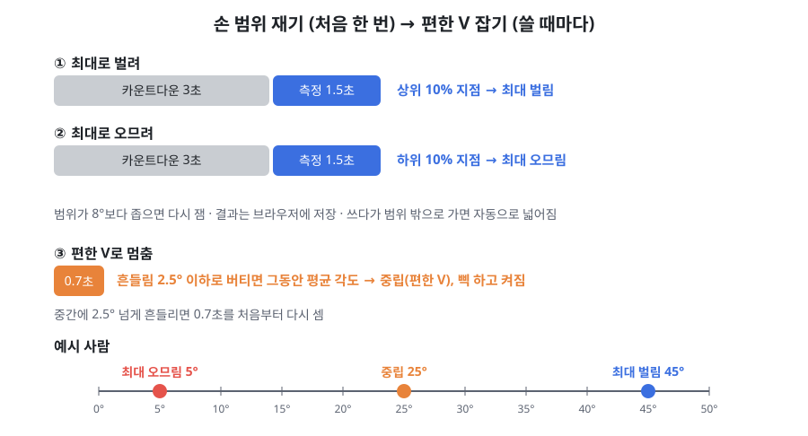
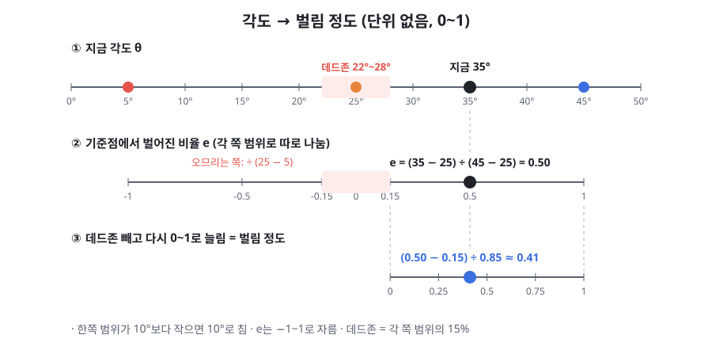
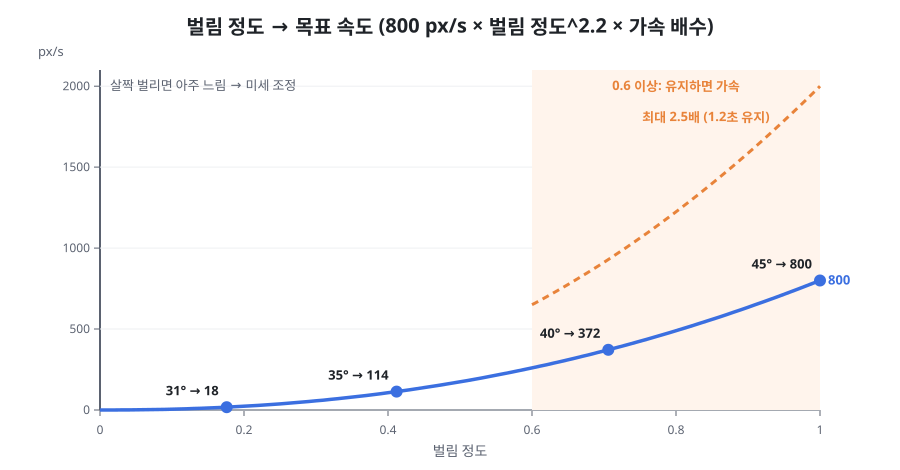
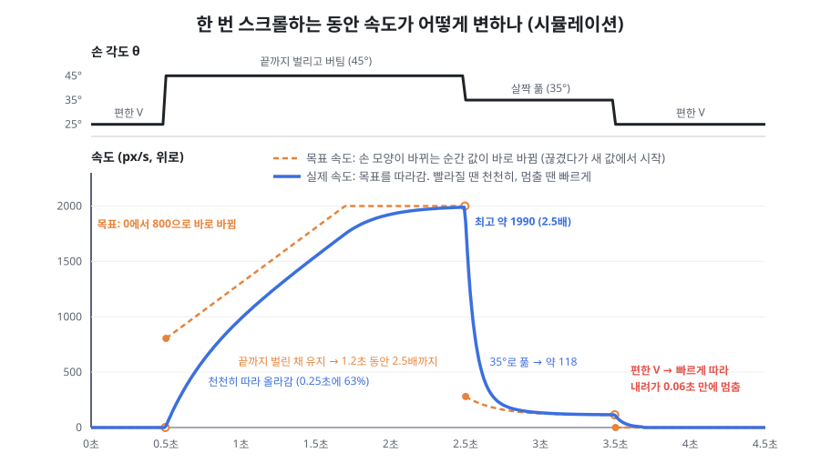

# GripSpread

컵을 든 손 그대로 검지와 중지를 벌렸다 오므려서 노트북 화면을 스크롤하는 입력 기법이다.
노트북 웹캠과 MediaPipe Hands로 손을 추적하고, 손에 아무것도 달지 않은 채 브라우저에서 바로 돌아간다.

CSE333 HCI개론 (UNIST, 2026 가을) Team 10 프로젝트.

[English version below ↓](#english)

## 파일

| 경로 | 내용 |
|---|---|
| `dist/gripspread_core.html` | 데모용 프로토타입. 예시 문서(도시 열섬 강의자료)를 GripSpread로 스크롤해볼 수 있다 |
| `dist/gripspread_experiment.html` | 실험 프로그램. 스크롤 Fitts 과제로 트랙패드와 GripSpread를 비교하고, 순서는 균형 라틴 방격으로 정하고, 끝나면 NASA-TLX를 받는다 |
| `src/engine.js` | 실험 프로그램이 쓰는 GripSpread 엔진 (손 추적 → 벌림 각도 → 상태 → 스크롤 속도) |
| `src/core_template.html` | 프로토타입 원본. 빌드하면 예시 문서 이미지가 안에 들어간다 |
| `src/experiment_template.html` | 실험 프로그램 원본. 빌드하면 `engine.js`가 안에 들어간다 |
| `assets/sample_doc_pages/` | 예시 문서 페이지 이미지 |
| `docs/` | 아래 설명에 쓰는 그림 |

`dist/`의 두 파일은 파일 하나만 있으면 돌아간다. 크롬에서 열고 카메라를 허용하면 된다. 손 인식 모델은 처음 열 때 인터넷에서 받아온다.
컵 IMU를 블루투스로 연결하려면 크롬을 써야 한다. 사파리는 Web Bluetooth를 지원하지 않는다.

## 빌드

`src/`를 고친 뒤:

```bash
./build.sh
```

## 한눈에 보기

- **벌림 각도 θ:** 검지·중지 뿌리(5, 9)의 중간점에서 두 손가락 끝(8, 12)을 본 각도. 손바닥 평면(0, 5, 17)에 투영해서 손가락을 앞뒤로 구부린 성분은 뺀다. 끝을 붙이면 0°.
- **입력 멈춤:** 손 옆면이 카메라를 향하거나(손바닥 법선과 카메라 축의 |cos| < 0.35), 손가락이 접히면(펴짐 비율 < 0.55 또는 마디 굽힘 합 > 80°가 0.1초 이상) 스크롤하지 않는다.
- **캘리브레이션:** 사람마다 최대로 벌린 각도와 최대로 오므린 각도를 한 번 재고, 쓸 때마다 편한 V를 중립으로 잡는다. 벌리는 쪽과 오므리는 쪽은 각자의 범위로 따로 나눈다.
- **속도:** `800 px/s × 벌림 정도^2.2 × 가속 배수`. 세게 벌리거나 오므린 채 버티면 가속 배수가 최대 2.5배까지 오르고, 손을 풀면 0.2초쯤에 1배로 돌아온다. 실제 속도는 빨라질 땐 0.25초, 느려질 땐 0.06초 시간상수로 목표를 따라간다.
- **방향:** 오므리면 아래로, 벌리면 위로.

단계별 설명과 예시는 아래 [송준혁의 친절한 알고리즘 설명](#송준혁의-친절한-알고리즘-설명)에 있다.

## 실험 데이터

참가자 한 명당 zip 파일 하나가 저장된다 (`P01_trials.csv`, `P01_frames.csv`, `P01_tlx.csv`, `P01_session.json`, IMU를 연결했으면 `P01_imu.csv`).
조건이 하나 끝날 때마다 브라우저(IndexedDB)에도 백업되고, 설정 화면에서 되살릴 수 있다.
참가자 데이터는 git에 올리지 않는다 (`.gitignore`).

---

## 송준혁의 친절한 알고리즘 설명

웹캠 화면 한 장이 스크롤 속도가 되기까지 일곱 단계를 거친다. 아래 숫자는 지금 코드(`src/engine.js`)에 들어 있는 값이고, 파일럿을 하면서 다시 맞출 예정이다.

예시로 쓸 사람: **편한 V = 25°, 최대로 벌렸을 때 = 45°, 최대로 오므렸을 때 = 5°**

### 1. 손 관절 찾기

웹캠 영상을 MediaPipe Hands에 넣으면 손 관절 21개의 3D 좌표가 나온다. 여기서 쓰는 번호는 이렇다: 손목 0, 검지 뿌리 5, 검지 끝 8, 중지 뿌리 9, 중지 끝 12, 새끼 뿌리 17.

### 2. 벌림 각도 θ 재기


- 검지 뿌리(5)와 중지 뿌리(9)의 **중간점 M**을 꼭짓점으로 두고, M에서 검지 끝(8)과 중지 끝(12)을 바라본 V자 각도를 잰다.
- **왜 중간점 하나로 잡았나:** 처음엔 검지 방향(5→8)과 중지 방향(9→12) 사이 각도를 쟀다. 그런데 두 뿌리는 원래 2cm쯤 떨어져 있어서, 손끝을 붙여도 두 선이 비스듬히 만난다. 그래서 손가락을 딱 붙였는데도 14° 정도로 읽혔고, 이 값도 사람마다 달랐다. 꼭짓점을 M 하나로 두면 끝 두 개가 붙었을 때 M에서 같은 점을 보게 되니까 정확히 0°가 나온다.
- 두 방향은 **손바닥 평면**(0, 5, 17로 만든 면)에 투영해서 잰다. 그러면 손가락을 앞뒤로 구부린 만큼은 빠지고, 옆으로 벌린 만큼만 남는다.
- 손을 돌려도 값이 거의 그대로다. 처음 방식(손끝 거리 ÷ 손바닥 폭)은 손만 돌려도 값이 달라졌다.
- 떨림은 지수 평활로 줄인다: `θ ← θ + 0.35 × (새 값 − θ)`
- 한 프레임 만에 20° 넘게 튀면 버린다. 다만 3프레임 연속으로 그러면 실제로 움직인 걸로 보고 받아들인다.

**정확한 식** (p₀, p₅ … 는 MediaPipe world 좌표의 관절 위치)

```
n  = 정규화( (p₅ − p₀) × (p₁₇ − p₀) )     손바닥 법선: 손바닥 위 두 벡터의 외적
M  = (p₅ + p₉) ÷ 2                       꼭짓점: 검지·중지 뿌리의 중간점
proj(v) = v − (v·n) n                    v에서 법선 방향 성분을 빼서 손바닥 평면에 투영
a  = proj(p₈ − M),  b = proj(p₁₂ − M)    M에서 두 손가락 끝을 향한 벡터 (투영 후)
θ  = arccos( a·b ÷ (|a| |b|) )           두 벡터 사이 각도
```

### 3. 못 믿을 값이면 입력 끊기


웹캠은 손이 잘 보일 때만 믿을 수 있다. 아래 세 경우에는 MediaPipe가 가려진 손가락 위치를 짐작해서 내놓기 때문에, 그 값으로 스크롤하면 엉뚱하게 움직인다. 그래서 이럴 땐 스크롤을 멈춘다. 컵을 고쳐 쥐는 동작은 대부분 여기에 걸려서 입력으로 들어가지 않는다.

**① 손바닥이 옆으로 돌았을 때**
- 손바닥 법선은 손바닥에서 수직으로 튀어나온 화살표라고 생각하면 된다.
- 손등이나 손바닥이 카메라를 마주 보면 이 화살표가 카메라 쪽을 가리킨다. 카메라 축과의 |cos| 값이 1에 가깝다.
- 손을 옆으로 돌려 옆면이 카메라를 향하면 화살표가 카메라와 직각이 된다. 값이 0에 가깝다.
- **0.35 아래**(대략 70° 넘게 돌린 상태)면 손가락이 겹쳐 보여서 각도를 믿을 수 없다. 이때 멈춘다.

**② 손가락이 접혔을 때**
- 컵을 꽉 감싸 쥐거나 주먹을 쥐면 검지·중지가 구부러지고, 이때도 각도가 엉뚱하게 나온다. 아래 둘 중 하나만 걸려도 접힌 걸로 본다.
- **펴짐 비율** = 손바닥 평면에 투영한 손가락 길이(뿌리→끝) ÷ 손바닥 길이(손목→중지 뿌리). 쭉 펴면 0.8~1쯤 되고, 구부리면 끝이 손바닥 쪽으로 말려서 짧아진다. **0.55 아래**면 접힘.
- **마디 굽힘 합** = 손가락 가운데 마디와 끝 마디가 꺾인 각도를 더한 값. **80° 넘으면** 접힘.
- 한 프레임만 그렇게 나오면 잡음일 수 있으니, **6프레임(약 0.1초) 연속**일 때만 멈춘다. 그보다 짧으면 바로 앞 각도를 그대로 쓴다.

**③ 손이 안 보일 때**
- 손이 화면에서 **0.5초 넘게** 안 보이면 처음 상태로 돌아간다.
- 다시 손을 올리고 편한 V로 0.7초 멈춰야 켜진다. 그래서 손을 내렸다 올릴 때 갑자기 스크롤되는 일이 없다.

**정확한 식**

```
손 방향        = |n_z|                         n의 카메라 축(z) 성분 = 법선과 카메라 축 사이 cos의 크기
펴짐 비율(검지) = |a| ÷ |p₉ − p₀|               투영된 M→검지 끝 길이 ÷ 손바닥 길이 (중지는 |b|)
마디 굽힘 합    = ∠(p₆−p₅, p₇−p₆) + ∠(p₇−p₆, p₈−p₇)   가운데 마디(PIP)와 끝 마디(DIP)에서 뼈 방향이 꺾인 각도 (중지는 9~12번)
```

### 4. 손 범위 재기 (처음 한 번)와 5. 편한 V 잡기 (쓸 때마다)



**손 범위 재기**
1. "최대로 벌려" → 3초 카운트다운(삑삑삑) → 1.5초 동안 잰 값 중 위에서 10% 지점(90번째 백분위수)을 **최대 벌림**으로 저장한다. 맨 끝값 대신 이걸 쓰는 건 한두 프레임 튄 값에 끌려가지 않기 위해서다.
2. "최대로 오므려" → 같은 방식으로 아래에서 10% 지점(10번째 백분위수)을 **최대 오므림**으로 저장한다.
3. 두 값 차이가 8°도 안 되면 잘못 잰 걸로 보고 다시 잰다. 결과는 브라우저에 남아서 다음에 열어도 그대로 쓴다.
4. 쓰다가 저장한 범위 밖까지 벌리거나 오므리면 범위가 그만큼 알아서 넓어진다.

**편한 V 잡기**
- 손이 카메라에 들어오면 "편한 V로 잠깐 멈춰" 상태가 된다.
- **0.7초 동안** 흔들림(표준편차)이 2.5° 이하로 버티면, 그동안의 평균 각도를 **중립**으로 잡고 입력이 켜진다(삑).
- 중간에 2.5° 넘게 흔들리면 0.7초를 처음부터 다시 센다.
- 예시 사람은 편한 V로 멈췄을 때 25°가 나왔다고 하자.

### 6. 벌림 정도 계산 (단위 없음, 0~1)



**① 기준점에서 얼마나 벌어졌나 (비율 e)**

```
벌리는 쪽:   e = (θ − 중립) ÷ (최대 벌림 − 중립)
오므리는 쪽: e = (θ − 중립) ÷ (중립 − 최대 오므림)
```

- 각도(°)를 각도(°)로 나누니까 단위가 없다.
- 벌리는 쪽과 오므리는 쪽을 **따로** 나눈다. 편한 V에서 오므릴 수 있는 폭이 벌릴 수 있는 폭보다 큰 사람이 많아서다.
- 한쪽 범위가 10°도 안 되게 재졌으면 10°로 친다. 범위가 너무 좁으면 조금만 움직여도 끝까지 간 걸로 잡히기 때문이다.
- e는 −1~1 밖으로 나가면 잘라낸다.
- 예시 사람은 벌리는 쪽 범위 = 45 − 25 = 20°, 오므리는 쪽 범위 = 25 − 5 = 20°.

**② 데드존 빼기**

```
벌림 정도 = (|e| − 0.15) ÷ (1 − 0.15)    (0보다 작으면 0)
```

- 각 쪽 범위의 15% 안쪽은 멈춘 걸로 본다. 예시 사람은 **22°~28°**에서는 스크롤되지 않는다.
- 데드존을 넘은 만큼을 다시 0~1로 늘린다. 끝까지 벌리면 1이다.

### 7. 속도 만들기

**① 기본 속도: 휘어진 곡선**



```
목표 속도 = 800 px/s × 벌림 정도^2.2 × 가속 배수
```

- 2.2제곱이라서 살짝 벌리면 아주 느리고, 끝까지 가면 확 빨라진다. 표적 근처에서 조금씩 맞추기 쉽다.
- 방향: 벌리면 위로, 오므리면 아래로.

**② 버티면 붙는 가속 (가속 배수)**

- 벌림 정도가 **0.6 이상**인 채로 버티면 배수가 1.2초에 걸쳐 **1배에서 2.5배까지** 일정하게 오른다. 긴 문서를 빨리 넘길 때 쓴다.
- 0.6 아래로 풀면 배수가 0.2초 시간상수로 1배로 내려온다(0.2초 뒤엔 붙었던 가속의 37%, 0.6초 뒤엔 5%만 남는다). 표적에 가까워지면서 손을 풀면 저절로 느려진다.
- 방향을 바꾸거나 데드존에 들어가면 곧바로 1배로 돌아간다.

**③ 실제 속도는 목표를 천천히 또는 빠르게 따라간다**



- 스크롤 속도는 목표 속도로 바로 뛰지 않고 따라가는 방식이다.
- 빨라질 때는 시간상수 **0.25초**: 0.25초면 목표의 63%까지 올라간다.
- 느려지거나 방향을 바꿀 때는 시간상수 **0.06초**: 0.2초면 거의 선다.
- 목표가 0인데 실제 속도가 5 px/s 아래로 내려가면 그냥 0으로 끊는다.
- 그래서 세게 벌리면 부드럽게 빨라지고, 풀면 바로 선다.
- 위 그래프는 엔진 계산식을 그대로 돌려서 그린 것이다. 0.5초에 끝까지 벌리고, 2.5초에 35°로 풀고, 3.5초에 편한 V로 돌아온 경우다.

**정확한 식** (Δt = 직전 프레임과의 시간 간격)

```
가속 배수 B
  같은 방향으로 벌림 정도 ≥ 0.6 유지:  B ← min(2.5, B + (2.5 − 1) × Δt ÷ 1.2초)    직선으로 증가
  그 밖 (0.6 미만으로 풂):             B ← 1 + (B − 1) × e^(−Δt ÷ 0.2초)           지수적으로 1배로 복귀
  방향이 바뀌거나 데드존:               B ← 1

목표 속도   u = 방향 × 800 × 벌림 정도^2.2 × B
실제 속도   v ← v + (u − v) × (1 − e^(−Δt ÷ τ))      1차 저역통과 필터
            τ = 0.25초 (|u| > |v|로 빨라질 때) / 0.06초 (느려지거나 방향을 바꿀 때)
            u = 0이고 |v| < 5 px/s 이면 v = 0
```

### 예시 계산 (편한 V 25°, 최대 벌림 45°, 최대 오므림 5°)

| 지금 각도 | e | 벌림 정도 | 목표 속도 (가속 전) | 1.2초 버티면 |
|---|---|---|---|---|
| 22°~28° | ±0.15 안 | 0 | 0 (멈춤) | — |
| 31° | 0.30 | 0.18 | 약 18 px/s 위로 | 가속 없음 (0.6 미만) |
| 35° | 0.50 | 0.41 | 약 114 px/s 위로 | 가속 없음 (0.6 미만) |
| 40° | 0.75 | 0.71 | 약 372 px/s 위로 | 약 930 px/s |
| 45° (끝까지) | 1.00 | 1.00 | 800 px/s 위로 | 2,000 px/s |
| 15° | −0.50 | 0.41 | 약 114 px/s 아래로 | 가속 없음 |
| 5° (끝까지) | −1.00 | 1.00 | 800 px/s 아래로 | 2,000 px/s |

**31° 줄을 직접 풀어보면**

```
e        = (31 − 25) ÷ 20          = 0.30
벌림 정도 = (0.30 − 0.15) ÷ 0.85    ≈ 0.18
목표 속도 = 800 × 0.18^2.2          ≈ 800 × 0.022 ≈ 18 px/s
```

### 한 번 스크롤할 때 일어나는 일

1. 컵을 든 채 손을 카메라 앞에 올리고 편한 V로 0.7초 멈춘다 → 삑, 켜짐
2. 끝까지 벌린다(45°) → 0.25초쯤 지나면 800 px/s에 가까워지고, 계속 버티면 1.2초에 걸쳐 2,000 px/s까지 빨라진다
3. 표적이 보이면 35°쯤으로 살짝 푼다 → 가속이 0.2초 만에 빠지고 약 114 px/s로 천천히 다가간다
4. 편한 V(25°)로 돌아온다 → 0.06초 시간상수로 바로 선다
5. 그 사이 컵을 고쳐 쥐느라 손가락이 접히면 → 0.1초 안에 입력이 끊겨서 엉뚱하게 스크롤되지 않는다

### 파일럿에서 다시 맞출 값

| 이름 | 지금 값 | 뜻 |
|---|---|---|
| `dead` | 0.15 | 데드존 (각 쪽 범위에 대한 비율) |
| `gain` | 800 px/s | 끝까지 벌렸을 때 기본 속도 |
| `gamma` | 2.2 | 곡선 지수 (클수록 조금 움직일 때 더 느림) |
| `boostOn` | 0.6 | 가속이 붙기 시작하는 벌림 정도 |
| `boostMax` / `boostMs` | 2.5배 / 1.2초 | 최대 가속 배수와 거기까지 걸리는 시간 |
| `boostDecayMs` | 0.2초 | 손을 풀었을 때 가속이 빠지는 시간상수 |
| `accMs` / `brakeMs` | 0.25초 / 0.06초 | 빨라질 때 / 느려질 때 따라가는 시간상수 |
| `minSide` | 10° | 한쪽 범위의 최솟값 |
| `holdMs` | 0.7초 | 중립을 잡을 때 멈춰 있어야 하는 시간 |
| `smooth` | 0.35 | 각도 평활 계수 |
| `curlMax` | 80° | 이보다 마디가 많이 꺾이면 접힌 걸로 본다 |

---

<a id="english"></a>

## English

GripSpread lets you scroll a laptop screen with the hand that is holding a cup, by spreading and closing the index and middle fingers.
It tracks the hand with the laptop webcam and MediaPipe Hands, needs nothing worn on the hand, and runs in the browser.

Team 10 project for CSE333 Introduction to HCI (UNIST, Fall 2026).

### Files

| Path | What it is |
|---|---|
| `dist/gripspread_core.html` | Demo prototype. Scroll a sample document (lecture notes on urban heat islands) with GripSpread |
| `dist/gripspread_experiment.html` | Study program. Scroll Fitts task comparing the trackpad and GripSpread, balanced Latin square order, NASA-TLX |
| `src/engine.js` | GripSpread engine used by the study program (hand tracking → spread angle → state → scroll velocity) |
| `src/core_template.html` | Prototype source. The build inlines the sample document images |
| `src/experiment_template.html` | Study program source. The build inlines `engine.js` |
| `assets/sample_doc_pages/` | Sample document page images |
| `docs/` | Figures used in this README |

Each file in `dist/` runs on its own. Open it in Chrome and allow the camera. The hand model is downloaded the first time.
Connecting the cup IMU over Bluetooth needs Chrome (Safari has no Web Bluetooth). To rebuild after editing `src/`, run `./build.sh`.

Participant data is saved as one zip per participant, backed up in the browser (IndexedDB) after each condition, and never committed (`.gitignore`).

### How it works

The figures above are labeled in Korean; the steps below follow the same order. Numbers are the current values in `src/engine.js` and will be retuned in the pilot.

Example user: **comfortable V = 25°, fully open = 45°, fully closed = 5°**

**1. Hand landmarks.** MediaPipe Hands gives 21 3D hand landmarks from the webcam. We use: wrist 0, index base 5, index tip 8, middle base 9, middle tip 12, little-finger base 17.

**2. Spread angle θ.**
- Vertex at the **midpoint M** of the index and middle knuckles (5, 9); θ is the angle at M between the index tip (8) and the middle tip (12).
- Why one vertex: our first version measured the angle between the two finger directions (5→8 and 9→12). The knuckles are about 2 cm apart, so with the fingertips touching the two lines still meet at a slant and read about 14°, differently for each person. With a single vertex at M, touching tips are the same point seen from M, so closed fingers read exactly 0°.
- Both directions are projected onto the **palm plane** (through landmarks 0, 5, 17), which removes forward/backward finger bending and keeps only the sideways spread.
- Rotating the hand barely changes θ. Our earlier ratio (fingertip distance ÷ palm width) changed with rotation alone.
- Smoothing: `θ ← θ + 0.35 × (new − θ)`. A jump over 20° in one frame is dropped, unless it lasts 3 frames.

Exact formulas (p₀, p₅ … are MediaPipe world-landmark positions):

```
n  = normalize( (p₅ − p₀) × (p₁₇ − p₀) )   palm normal (cross product of two in-palm vectors)
M  = (p₅ + p₉) / 2                          vertex: midpoint of the index and middle knuckles
proj(v) = v − (v·n) n                       projection onto the palm plane
a  = proj(p₈ − M),  b = proj(p₁₂ − M)
θ  = arccos( a·b / (|a| |b|) )
```

**3. Freeze input when the reading can't be trusted.** In these cases MediaPipe guesses hidden finger positions, so we stop scrolling. Most regrips of the cup fall into one of them.
- *Palm turned sideways:* |cos| between the palm normal and the camera axis < 0.35 (roughly more than 70° of rotation).
- *Fingers folded:* extension ratio (projected base→tip length ÷ palm length, wrist→middle base) < 0.55, or the summed bend of the middle and end joints > 80°, for 6 consecutive frames (~0.1 s). Shorter blips keep the last angle.
- *Hand lost:* more than 0.5 s → back to the start state; the user must hold a comfortable V again.

Exact formulas: facing = |n_z| (the camera-axis component of the palm normal); extension (index) = |a| / |p₉ − p₀| (middle uses |b|); joint bend = ∠(p₆−p₅, p₇−p₆) + ∠(p₇−p₆, p₈−p₇), i.e. the bend at the PIP and DIP joints (middle uses 9–12).

**4. Hand range (once).** "Open fully": 3 s countdown, 1.5 s capture, the 90th percentile becomes *max open*. "Close fully": same, the 10th percentile becomes *max closed*. Percentiles instead of the extremes keep one noisy frame from setting the range. A range under 8° is rejected. The result is stored in the browser, and it widens on its own if the user later goes past it.

**5. Neutral (every time).** When the hand appears, hold a comfortable V. If it stays within 2.5° (standard deviation) for **0.7 s**, the mean angle becomes *neutral* and input turns on with a beep. More wobble restarts the 0.7 s.

**6. Deflection (unitless, 0–1).**

```
opening side: e = (θ − neutral) ÷ (max open − neutral)
closing side: e = (θ − neutral) ÷ (neutral − max closed)
deflection    = (|e| − 0.15) ÷ (1 − 0.15)      (clamped at 0)
```

- Each side is normalized by its own range, because most people can close further from their comfortable V than they can open. Each side range is at least 10°, and e is clamped to −1…1.
- The inner 15% of each side is a dead zone. For the example user, 22°–28° does nothing.

**7. Velocity.**

```
target velocity = 800 px/s × deflection^2.2 × boost
```

- The 2.2 exponent makes small deflections very slow and full deflection fast, which helps fine positioning near the target. Opening scrolls up, closing scrolls down.
- *Boost:* while deflection ≥ 0.6 is held, the boost rises linearly from 1× to 2.5× over 1.2 s. Below 0.6 it decays back to 1× with a 0.2 s time constant. A direction change or the dead zone resets it to 1× at once.
- *Following:* the actual velocity follows the target with a 0.25 s time constant when speeding up and 0.06 s when slowing down or reversing, and snaps to 0 below 5 px/s when the target is 0. Speeding up feels smooth and releasing stops right away.

Exact update per frame (Δt = time since the last frame):

```
boost B:   held, same direction, deflection ≥ 0.6:  B ← min(2.5, B + 1.5 · Δt / 1.2 s)   (linear)
           otherwise:                               B ← 1 + (B − 1) · exp(−Δt / 0.2 s)
           direction change or dead zone:           B ← 1
target     u = direction · 800 · deflection^2.2 · B
velocity   v ← v + (u − v) · (1 − exp(−Δt / τ))     first-order low-pass
           τ = 0.25 s when speeding up (|u| > |v|), 0.06 s when slowing or reversing
           v = 0 when u = 0 and |v| < 5 px/s
```

**Worked example (comfortable V 25°, max open 45°, max closed 5°)**

| Angle | e | Deflection | Target velocity (no boost) | After holding 1.2 s |
|---|---|---|---|---|
| 22°–28° | within ±0.15 | 0 | 0 (stop) | — |
| 31° | 0.30 | 0.18 | ~18 px/s up | no boost (< 0.6) |
| 35° | 0.50 | 0.41 | ~114 px/s up | no boost (< 0.6) |
| 40° | 0.75 | 0.71 | ~372 px/s up | ~930 px/s |
| 45° | 1.00 | 1.00 | 800 px/s up | 2,000 px/s |
| 15° | −0.50 | 0.41 | ~114 px/s down | no boost |
| 5° | −1.00 | 1.00 | 800 px/s down | 2,000 px/s |

**Parameters to retune in the pilot:** `dead` 0.15, `gain` 800 px/s, `gamma` 2.2, `boostOn` 0.6, `boostMax` 2.5×, `boostMs` 1.2 s, `boostDecayMs` 0.2 s, `accMs` 0.25 s, `brakeMs` 0.06 s, `minSide` 10°, `holdMs` 0.7 s, `smooth` 0.35, `curlMax` 80°.
