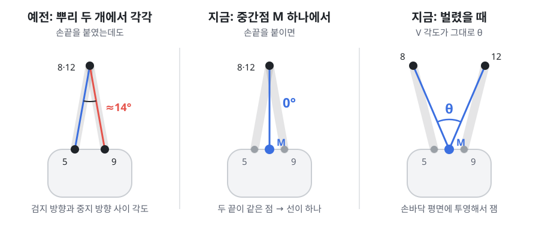
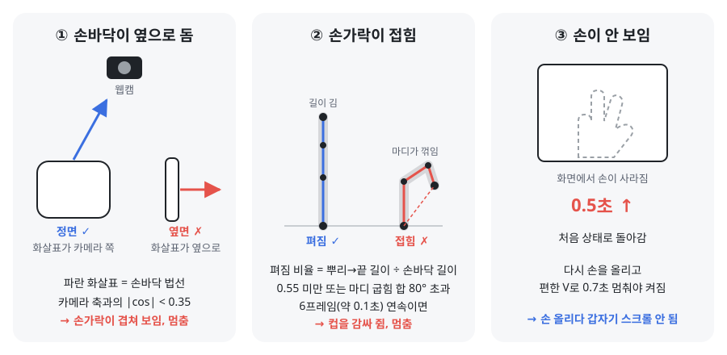

# GripSpread

컵을 쥔 손으로 검지·중지를 벌리고 오므려서 노트북 화면을 스크롤하는 입력 기법.
웹캠과 MediaPipe Hands로 손을 추적하고, 별도 장비 없이 브라우저에서 돌아간다.

CSE333 HCI개론 (UNIST, 2026 가을) Team 10 프로젝트.

## 파일

| 경로 | 내용 |
|---|---|
| `dist/gripspread_core.html` | 데모용 프로토타입. 예시 문서(도시 열섬 강의자료)를 GripSpread로 스크롤한다 |
| `dist/gripspread_experiment.html` | 실험 프로그램. 스크롤 Fitts 과제, 트랙패드/GripSpread 비교, 균형 라틴 방격 순서, NASA-TLX |
| `src/engine.js` | 실험 프로그램이 쓰는 GripSpread 엔진 (손 추적 → 벌림 각도 → 상태 → 스크롤 속도) |
| `src/core_template.html` | 프로토타입 원본. 빌드할 때 예시 문서 이미지가 들어간다 |
| `src/experiment_template.html` | 실험 프로그램 원본. 빌드할 때 `engine.js`가 들어간다 |
| `assets/sample_doc_pages/` | 예시 문서 페이지 이미지 |

`dist/`의 두 파일은 각각 파일 하나로 완결된다. 크롬에서 열고 카메라를 허용하면 된다 (손 인식 모델은 처음 열 때 인터넷에서 받는다).
컵 IMU를 블루투스로 연결하려면 크롬이 필요하다 (사파리는 Web Bluetooth 미지원).

## 빌드

`src/`를 고친 뒤:

```bash
./build.sh
```

## 측정 방식 (요약)

- **벌림 각도 θ:** 검지·중지 뿌리(5, 9)의 중간점에서 두 손가락 끝(8, 12)을 본 각도. 손바닥 평면(0, 5, 17)에 투영해서 손가락 굽힘 성분을 뺀다. 끝을 붙이면 0°.
- **입력 멈춤:** 손바닥이 카메라에 옆면으로 보이거나(|법선·카메라축| < 0.35), 손가락이 접히면(펴짐 < 0.55 또는 마디 굽힘 > 80°가 0.1초 이상) 스크롤하지 않는다.
- **캘리브레이션:** 사람마다 손 범위(최대로 벌림, 최대로 오므림)를 재고, 쓸 때마다 편한 V(중립)를 잡는다. 벌리는 쪽과 오므리는 쪽을 각자의 범위로 정규화한다.
- **속도:** `기본 속도 × 벌림 정도^곡선지수 × 가속 배수`. 가속 배수는 세게 벌리거나 오므린 채로 유지할 때만 올라가고(최대 2.5배), 손을 풀면 0.2초 안에 1배로 돌아온다. 실제 속도는 빨라질 때 0.25초, 느려질 때 0.06초 시간상수로 따라간다.
- 기본 방향: 오므리면 아래로, 벌리면 위로.

자세한 설명과 예시는 아래 [송준혁의 친절한 알고리즘 설명](#송준혁의-친절한-알고리즘-설명)에 있다.

## 실험 데이터

참가자 1명당 zip 하나가 저장된다 (`P01_trials.csv`, `P01_frames.csv`, `P01_tlx.csv`, `P01_session.json`, IMU 연결 시 `P01_imu.csv`).
조건이 끝날 때마다 브라우저(IndexedDB)에도 백업되고, 설정 화면에서 복구할 수 있다.
참가자 데이터는 git에 올리지 않는다 (`.gitignore`).

---

## 송준혁의 친절한 알고리즘 설명

손 사진 한 장이 스크롤 속도가 되기까지 일곱 단계를 거친다. 아래 숫자는 지금 코드(`src/engine.js`)에 들어 있는 값이고, 파일럿에서 다시 조정할 예정이다.

예시로 쓸 사람: **편한 V = 25°, 최대로 벌림 = 45°, 최대로 오므림 = 5°**

### 1. 손 관절 찾기

웹캠 영상에서 MediaPipe Hands로 손 관절 21개의 3D 좌표를 얻는다. 손목이 0번, 검지 뿌리가 5번, 중지 뿌리가 9번, 검지 끝이 8번, 중지 끝이 12번, 새끼 뿌리가 17번이다.

### 2. 벌림 각도 θ 재기



- 검지 뿌리(5)와 중지 뿌리(9)의 **중간점 M**을 꼭짓점으로 잡고, M에서 검지 끝(8)과 중지 끝(12)을 본 V자 각도를 잰다.
- **왜 중간점 하나냐:** 예전엔 검지 방향(5→8)과 중지 방향(9→12) 사이 각도를 쟀다. 그런데 뿌리 두 개는 원래 2cm쯤 떨어져 있어서, 손끝을 붙이면 두 선이 서로 기울어진 채 만난다. 그래서 손가락을 완전히 붙였는데도 14° 정도 벌렸다고 읽었고, 이 값도 사람마다 달랐다. 꼭짓점을 M 하나로 잡으면 끝 두 개가 붙었을 때 M에서 같은 점을 보게 되니까 정확히 0°가 나온다.
- 두 방향은 **손바닥 평면**(0, 5, 17이 이루는 면)에 투영해서 잰다. 손가락을 앞뒤로 구부린 성분은 빠지고, 옆으로 벌린 성분만 남는다.
- 손을 돌려도 값이 거의 안 변한다. 예전 방식(손끝 거리 ÷ 손바닥 폭)은 손만 돌려도 값이 바뀌었다.
- 떨림을 줄이려고 지수 평활을 건다: `θ ← θ + 0.35 × (새 값 − θ)`
- 한 프레임에 20° 넘게 튀는 값은 버린다. 다만 3프레임 연속이면 진짜 움직임으로 보고 받아들인다.

### 3. 믿을 수 없을 때는 입력 끊기



웹캠은 손이 잘 보일 때만 믿을 만하다. 아래 세 경우엔 MediaPipe가 가려진 손가락 위치를 추측해서 내놓기 때문에, 그 값으로 스크롤하면 엉뚱하게 움직인다. 그래서 스크롤을 멈춘다. 컵을 고쳐 쥐는 동작은 대부분 여기에 걸려서 입력으로 들어가지 않는다.

**① 손바닥이 옆으로 돌았을 때**
- 손바닥 법선은 손바닥에서 수직으로 뻗어 나오는 화살표다.
- 손등이나 손바닥이 카메라를 정면으로 보면 이 화살표가 카메라를 향한다 → 카메라 축과의 |cos| 값이 1에 가깝다.
- 손을 옆으로 돌려 옆면이 카메라를 향하면 화살표가 카메라와 직각이 된다 → 0에 가깝다.
- **0.35 미만**(대략 70° 넘게 돌린 상태)이면 손가락이 겹쳐 보여서 각도를 믿을 수 없다 → 멈춤.

**② 손가락이 접혔을 때**
- 컵을 꽉 감싸 쥐거나 주먹을 쥐면 검지·중지가 구부러지고, 이때도 각도가 엉뚱하게 나온다. 둘 중 하나만 걸려도 접힘으로 본다.
- **펴짐 비율** = 손바닥 평면에 투영한 뿌리→끝 길이 ÷ 손바닥 길이(손목→중지 뿌리). 쭉 펴면 0.8~1 정도고, 구부리면 끝이 손바닥 쪽으로 말려 짧아진다. **0.55 미만**이면 접힘.
- **마디 굽힘 합** = 손가락 가운데 마디와 끝 마디가 꺾인 각도의 합. **80° 초과**면 접힘.
- 한 프레임만 그렇게 나오는 건 노이즈일 수 있어서, **6프레임(약 0.1초) 연속**일 때만 멈춘다. 그보다 짧으면 직전 각도를 유지한다.

**③ 손이 안 보일 때**
- 손이 화면에서 **0.5초 넘게** 사라지면 처음 상태로 돌아간다.
- 다시 손을 올려서 편한 V로 0.7초 멈춰야 켜진다. 그래서 손을 내렸다 올릴 때 갑자기 스크롤되지 않는다.

### 4. 손 범위 재기 (처음 한 번)

1. "최대로 벌려" → 3초 카운트다운(삑삑삑) → 1.5초 동안 측정 → 상위 10% 지점(90번째 백분위수)을 **최대 벌림**으로 저장
2. "최대로 오므려" → 같은 방식 → 하위 10% 지점(10번째 백분위수)을 **최대 오므림**으로 저장
3. 범위가 8°보다 좁으면 다시 잰다. 결과는 브라우저에 저장돼서 다음에 열어도 남는다.
4. 쓰다가 저장된 범위 밖으로 벌리면 범위가 그만큼 자동으로 넓어진다.

### 5. 편한 V(중립) 잡기 (쓸 때마다)

- 손이 카메라에 들어오면 "편한 V로 잠깐 멈춰" 상태가 된다.
- **0.7초 동안** 각도가 거의 안 변하면(표준편차 2.5° 이하) 그 평균을 **중립 각도**로 잡고 입력이 켜진다(삑).
- 중간에 2.5° 넘게 흔들리면 0.7초를 처음부터 다시 센다.

예시 사람은 편한 V로 멈췄을 때 25°가 나왔다고 하자.

### 6. 벌림 정도 계산 (단위 없음, 0~1)

**① 기준점에서 얼마나 벌어졌나 (비율 e)**

```
벌리는 쪽:  e = (θ − 중립) ÷ (최대 벌림 − 중립)
오므리는 쪽: e = (θ − 중립) ÷ (중립 − 최대 오므림)
```

- 벌리는 쪽과 오므리는 쪽을 **따로** 나눈다. 대부분 사람은 편한 V에서 오므리는 쪽으로 움직일 수 있는 각도가 더 크다.
- 한쪽 범위가 10°보다 작으면 10°로 친다. 범위를 너무 작게 재서 조금만 움직여도 끝까지 간 걸로 잡히는 걸 막는다.
- e는 −1~1로 자른다.

예시 사람은 벌리는 쪽 범위 = 45 − 25 = 20°, 오므리는 쪽 범위 = 25 − 5 = 20°.

**② 데드존 빼기**

```
벌림 정도 = (|e| − 0.15) ÷ (1 − 0.15)    (0보다 작으면 0)
```

- 각 쪽 범위의 15% 안은 멈춤이다. 예시 사람은 **22°~28°**에서 스크롤이 안 된다.
- 데드존을 넘은 만큼을 다시 0~1로 늘린다. 끝까지 벌리면 1이다.

### 7. 속도 만들기

**① 기본 속도 (비선형 곡선)**

```
목표 속도 = 800 px/s × 벌림 정도^2.2 × 가속 배수
```

- 2.2제곱이라 살짝 움직이면 아주 느리고, 끝까지 가면 확 빨라진다. 표적 근처에서 미세 조정이 쉽다.
- 방향: 벌리면 위로, 오므리면 아래로.

**② 유지 시간 가속 (가속 배수)**

- 벌림 정도가 **0.6 이상**인 채로 유지하면 배수가 1.2초에 걸쳐 **1배 → 2.5배**까지 일정하게 올라간다. 긴 문서를 빨리 넘길 때 쓴다.
- 0.6 아래로 풀면 배수가 0.2초 시간상수로 1배로 돌아온다(0.2초 뒤 남은 가속의 37%, 0.6초 뒤 5%). 표적에 다가가며 손을 풀면 자동으로 느려진다.
- 방향을 바꾸거나 데드존에 들어가면 바로 1배로 리셋된다.

**③ 실제 속도가 따라가는 방식**

- 실제 스크롤 속도는 목표 속도를 바로 따라가지 않고 부드럽게 따라간다.
- 빨라질 때: 시간상수 **0.25초** (0.25초에 목표의 63%)
- 느려지거나 방향을 바꿀 때: 시간상수 **0.06초** (0.2초면 거의 멈춤)
- 목표가 0이고 실제 속도가 5 px/s 아래로 떨어지면 0으로 끊는다.
- 그래서 "세게 벌리면 부드럽게 빨라지고, 풀면 바로 선다"는 느낌이 난다.

### 예시 계산 (편한 V 25°, 최대 벌림 45°, 최대 오므림 5°)

| 지금 각도 | e | 벌림 정도 | 목표 속도 (가속 전) | 세게 1.2초 유지하면 |
|---|---|---|---|---|
| 22°~28° | ±0.15 이내 | 0 | 0 (멈춤) | — |
| 31° | 0.30 | 0.18 | 약 18 px/s 위로 | 가속 없음 (0.6 미만) |
| 35° | 0.50 | 0.41 | 약 114 px/s 위로 | 가속 없음 (0.6 미만) |
| 40° | 0.75 | 0.71 | 약 372 px/s 위로 | 약 930 px/s |
| 45° (끝까지) | 1.00 | 1.00 | 800 px/s 위로 | 2,000 px/s |
| 15° | −0.50 | 0.41 | 약 114 px/s 아래로 | 가속 없음 |
| 5° (끝까지) | −1.00 | 1.00 | 800 px/s 아래로 | 2,000 px/s |

**31° 줄 직접 계산해보기**

```
e        = (31 − 25) ÷ 20          = 0.30
벌림 정도 = (0.30 − 0.15) ÷ 0.85    ≈ 0.18
목표 속도 = 800 × 0.18^2.2          ≈ 800 × 0.022 ≈ 18 px/s
```

### 한 번 스크롤하는 흐름으로 보면

1. 컵을 든 채 손을 카메라 앞에 올리고 편한 V로 0.7초 멈춤 → 삑, 켜짐
2. 끝까지 벌림(45°) → 0.25초쯤 걸려 800 px/s까지 올라감 → 계속 유지하면 1.2초 동안 2,000 px/s까지 빨라짐
3. 표적이 보이면 35° 정도로 살짝 풂 → 가속이 0.2초 만에 빠지고 약 114 px/s로 천천히 다가감
4. 편한 V(25°)로 돌아옴 → 0.06초 시간상수로 바로 멈춤
5. 중간에 컵을 고쳐 쥐느라 손가락이 접히면 → 0.1초 안에 입력이 끊겨서 엉뚱하게 스크롤되지 않음

### 바뀔 수 있는 값 (파일럿에서 조정)

| 이름 | 지금 값 | 뜻 |
|---|---|---|
| `dead` | 0.15 | 데드존 (각 쪽 범위 대비 비율) |
| `gain` | 800 px/s | 끝까지 벌렸을 때 기본 속도 |
| `gamma` | 2.2 | 곡선 지수 (클수록 작은 움직임이 더 느림) |
| `boostOn` | 0.6 | 가속이 붙기 시작하는 벌림 정도 |
| `boostMax` / `boostMs` | 2.5배 / 1.2초 | 최대 가속 배수와 거기까지 걸리는 시간 |
| `boostDecayMs` | 0.2초 | 손을 풀었을 때 가속이 빠지는 시간상수 |
| `accMs` / `brakeMs` | 0.25초 / 0.06초 | 빨라질 때 / 느려질 때 따라가는 시간상수 |
| `minSide` | 10° | 한쪽 범위의 최소값 |
| `holdMs` | 0.7초 | 중립을 잡는 데 필요한 정지 시간 |
| `smooth` | 0.35 | 각도 평활 계수 |
| `curlMax` | 80° | 손가락 접힘으로 보는 마디 굽힘 합 |
